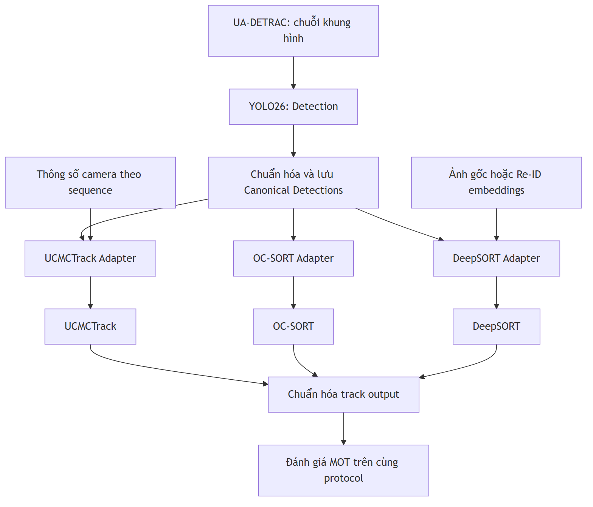

# Hợp đồng dữ liệu giữa YOLO26 và các thuật toán Tracking

**Dự án:** Vehicle Tracking trên UA-DETRAC  
**Detector:** YOLO26 (Ultralytics)  
**Trackers:** UCMCTrack, OC-SORT, DeepSORT  
**Mục đích:** Thống nhất đầu ra Detection, đầu vào Tracking và trách nhiệm chuyển đổi dữ liệu. Không quy định cách cài đặt thuật toán.

## 1. Nguyên tắc chung

YOLO26 chỉ thực hiện **phát hiện phương tiện**; ba tracker nhận **cùng một bộ detection** nhưng xử lý độc lập để tạo `track_id`. Không chạy lại detector, không tạo ba bộ detection khác nhau và không đưa `track_id` vào dữ liệu detection.

Nguồn sơ đồ: [diagrams/pipeline_vi.mmd](diagrams/pipeline_vi.mmd). Sau khi sửa, render lại bằng `npx -y @mermaid-js/mermaid-cli -i docs/diagrams/pipeline_vi.mmd -o docs/diagrams/pipeline_vi.png -b white -s 2`.

## 2. Đầu ra Detection của YOLO26

Với tác vụ **object detection** của Ultralytics, mỗi khung hình nhận một `Results` có `boxes`:

| Thuộc tính | Dạng | Ý nghĩa |
|---|---|---|
| `boxes.xyxy` | `N × 4` | `[x1, y1, x2, y2]`, tọa độ pixel trên ảnh gốc |
| `boxes.conf` | `N` | Độ tin cậy, trong khoảng 0–1 |
| `boxes.cls` | `N` | Mã lớp dự đoán; chuyển về số nguyên |
| `orig_shape` | `(height, width)` | Kích thước ảnh gốc |

`N` là số đối tượng phát hiện trong khung hình. Không lấy `boxes.xywh` mà mặc định hiểu là góc trên trái: trong Ultralytics, thuộc tính này biểu diễn **tâm hộp + chiều rộng, chiều cao**.

**Canonical Detection cho mỗi frame** được thống nhất là ma trận `N × 6`:

`[x1, y1, x2, y2, confidence, class_id]`

- `x1, y1`: góc trên trái; `x2, y2`: góc dưới phải; đơn vị pixel của **ảnh gốc**, không phải tọa độ chuẩn hóa.
- `confidence`: điểm tin cậy detection; `class_id`: mã lớp theo bảng ánh xạ đã chốt.
- Khi không có đối tượng: dùng ma trận rỗng có kích thước `(0, 6)`, **không bỏ qua frame**.
- Mỗi frame gắn `sequence_id`, `frame_id` (thống nhất bắt đầu từ 1) và `image_width`, `image_height`; lưu thêm FPS, nhãn lớp, cấu hình inference, tên/phiên bản weights ở metadata của sequence hoặc đợt chạy.
- Kiểm tra tọa độ hữu hạn, `x2 > x1`, `y2 > y1`, điểm tin cậy hợp lệ và class mapping trước khi lưu.

## 3. Điều kiện đầu vào và trách nhiệm của từng Adapter

| Tracker | Đầu vào tracker cần nhận | Trách nhiệm Adapter | Dữ liệu bổ sung |
|---|---|---|---|
| **UCMCTrack** | Các đối tượng Detection có `bb_left`, `bb_top`, `bb_width`, `bb_height`, `conf`, `det_class`; thông tin mặt đất `y`, ma trận sai số `R` | Đổi `xyxy` → góc trên trái + rộng/cao; khởi tạo Detection; dùng Mapper chiếu xuống mặt đường và tính `y, R`; cập nhật mỗi frame | **Camera parameters đúng sequence**, cấu hình Mapper và FPS |
| **OC-SORT** | Ma trận `N × 5`: `[x1, y1, x2, y2, score]` | Chọn năm cột đầu, giữ nguyên score; đảm bảo API nhận đúng hệ tọa độ và xử lý frame rỗng | Thông tin kích thước ảnh nếu API phiên bản đã chọn yêu cầu |
| **DeepSORT** | Các detection `([left, top, width, height], confidence, class)` | Đổi `xyxy` → góc trên trái + rộng/cao; chuyển class theo API; đồng bộ từng bbox với đặc trưng nhận dạng | **Ảnh gốc** hoặc **Re-ID embeddings** (vector đặc trưng ngoại hình) |

### Lưu ý riêng

**UCMCTrack:** Việc chiếu tọa độ xuống mặt đường phụ thuộc hiệu chỉnh camera. UA-DETRAC có nhiều góc quay nên cần xác lập hoặc ước lượng camera parameters theo từng sequence; không giả định dataset cung cấp sẵn thông số đủ dùng. Nếu chưa có thông số hợp lệ, phải báo lỗi/đánh dấu chưa sẵn sàng thay vì âm thầm dùng thông số tùy ý. Bản demo chính thức dùng `mapper.mapto(...)` trước `tracker.update(dets, frame_id)`.

**OC-SORT:** Bản gốc nhận `N × 5` và có phép chia bbox theo hệ số scale tính từ `img_info` và `img_size` **bên trong** phương thức `update`. Nếu canonical đã là pixel của ảnh gốc thì Adapter phải cấu hình hai kích thước sao cho scale bằng 1, hoặc điều chỉnh theo API của phiên bản được chốt. Tuyệt đối tránh scale hai lần. Khi frame rỗng, truyền `(0, 5)`.

**DeepSORT:** Canonical chỉ chứa bbox, score, class; **không chứa Re-ID embeddings**. Adapter phải cấp ảnh đúng frame để thư viện trích xuất đặc trưng, hoặc cấp embeddings đã tính sẵn, đồng thứ tự với detections. Cần cố định phiên bản thư viện: `deep-sort-realtime` dùng cấu trúc nêu trong bảng; DeepSORT gốc có giao diện khác.

## 4. Đầu ra Tracking và kiểm thử tích hợp

Tất cả tracker phải được chuẩn hóa về cùng dạng track: `frame_id`, `track_id`, `bbox_xyxy`, `class_id` (nếu xác định được), `score` (nếu có). Khi xuất file để đánh giá theo MOTChallenge, đổi bbox sang **góc trên trái + rộng/cao**:

`frame, track_id, left, top, width, height, score, -1, -1, -1`

Các trường score/metadata phải theo yêu cầu của bộ đánh giá được chọn; **không tự tạo confidence giả như thể đó là score của tracker**.

**Điều kiện nghiệm thu:** (1) cùng file canonical được nạp bởi cả ba Adapter; (2) frame rỗng không làm đứt đồng hồ tracking; (3) không nhầm `xyxy`, `xywh` tâm và `ltwh`; (4) class mapping thống nhất; (5) đúng hiệu chỉnh camera cho UCMCTrack và đúng đặc trưng ảnh cho DeepSORT; (6) cùng thứ tự frame, cùng tập test và cùng protocol đánh giá; (7) ghi rõ phiên bản/commit của ba thư viện.

## Tài liệu kỹ thuật đối chiếu

- Ultralytics YOLO26 Detection: https://docs.ultralytics.com/tasks/detect/
- Ultralytics Results API: https://docs.ultralytics.com/modes/predict/
- UCMCTrack (bản gốc): https://github.com/corfyi/UCMCTrack — xem `demo.py`.
- OC-SORT (bản gốc): https://github.com/noahcao/OC_SORT — xem `trackers/ocsort_tracker/ocsort.py`.
- DeepSORT API được mô tả: https://github.com/levan92/deep_sort_realtime — xem `deep_sort_realtime/deepsort_tracker.py`.
