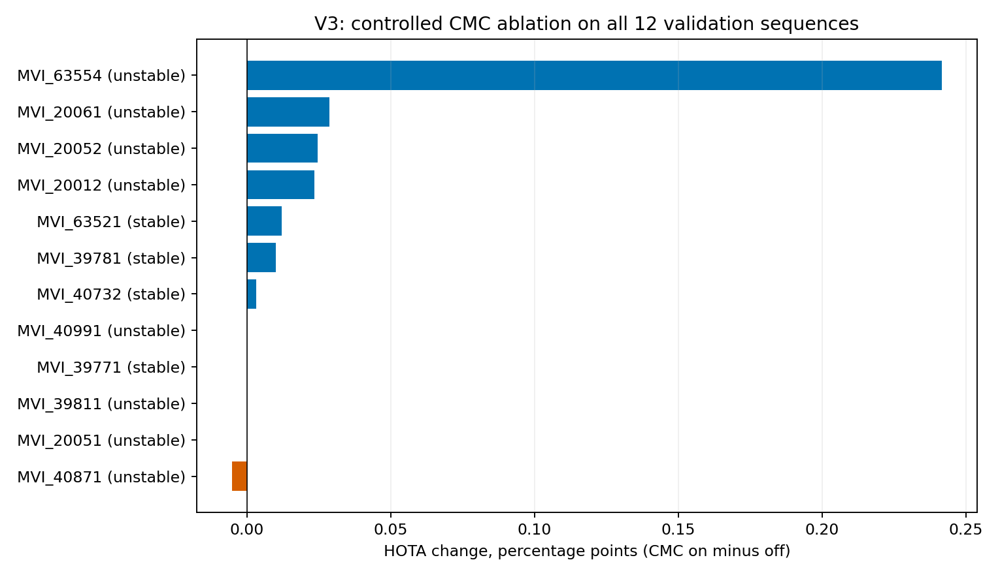

# Đối chứng CMC trên v3 và UCMCTrack upstream

> Báo cáo này giữ mốc calibration cũ để so sánh. Registry live sau đó đã có
> đủ 100 homography reviewed; lần chạy mới được ghi riêng trong
> [TRACKING_FINAL_REVIEWED_H100_REPORT.md](TRACKING_FINAL_REVIEWED_H100_REPORT.md).

Ngày: 28/11/2026. Môi trường local Windows. Thí nghiệm dùng detection CSV đã xuất,
không chạy lại YOLO. Các bảng kết quả được lấy từ artifact sau khi chạy hoàn tất.

## Kết quả val: đã hoàn tất 12/12 sequence

| Cấu hình | HOTA | IDF1 | MOTA | AssA | DetA | IDS | FP | FN | Frag |
| --- | ---: | ---: | ---: | ---: | ---: | ---: | ---: | ---: | ---: |
| Upstream + HP + CMC, tham số đã tune | 79,1887 | 87,5836 | 77,6044 | 82,6899 | 76,1224 | 132 | 11.540 | 14.401 | 971 |
| V3, không CMC | 79,9241 | 88,4183 | 78,0751 | 83,8585 | 76,4598 | 46 | 11.609 | 13.870 | 783 |
| **V3 + CMC** | **79,9514** | **88,4705** | **78,0940** | **83,9059** | **76,4682** | **42** | **11.602** | **13.859** | **778** |

CMC tăng **0,0273 điểm HOTA**, **0,0522 điểm IDF1**, giảm 4 IDS, 7 FP, 11 FN
và 5 Frag so với chính v3 không CMC. Đây là mức tăng nhỏ, không khẳng định có
ý nghĩa thống kê. HOTA tăng ở 7 sequence, giảm ở 1 và bằng nhau ở 4 sequence.
Tăng lớn nhất tại `MVI_63554`: +0,2416 HOTA, +0,4908 IDF1, IDS giảm 1; tại
`MVI_40871` giảm 0,0051 HOTA, tăng 1 FP và 1 FN. Không chọn CMC chỉ vì camera
unstable: kiểm tra aggregate cho cả hai nhóm đều tăng.



| Nhóm val | Số sequence | HOTA không CMC | HOTA có CMC | IDF1 không CMC | IDF1 có CMC | IDS không/có CMC |
| --- | ---: | ---: | ---: | ---: | ---: | ---: |
| Stable | 4 | 78,4387 | 78,4467 | 88,9583 | 88,9719 | 30 / 30 |
| Unstable | 8 | 80,5915 | 80,6272 | 88,1745 | 88,2441 | 16 / 12 |

So với upstream cùng HP/CMC và tham số số học, v3 + CMC tăng **0,7627 HOTA**,
**0,8869 IDF1**, giảm **90 IDS (68,2%)**, giảm 542 FN nhưng tăng 62 FP. Đây là
tác động tổng hợp của các sửa đổi v3, không quy toàn bộ cho CMC. Nhánh upstream
mới tái lập **byte-for-byte output của cả 12 sequence** trong run tham chiếu v2
`reproduce_v2_winner`; metric cũng trùng hoàn toàn.

`val_selection.json` đã chọn v3 + CMC trước khi chuẩn bị test. Tổng wall time
hai lượt mới và evaluation khoảng **13 phút**; riêng tracking pipeline v3 + CMC
184,0 giây và upstream 115,9 giây khi đã có cache optical flow. Chênh lệch với
runtime v3 lịch sử không phải phép đo tốc độ có kiểm soát. Lần đầu cần cộng
thời gian tính cache CMC; không báo cache hit như chi phí CMC từ đầu.

## Chuẩn bị CMC cho test

Đã tạo đủ **40 cache**, **56.340 frame**, thời gian thực **2.051,73 giây
(34,2 phút)** với 4 tiến trình, một OpenCV thread mỗi tiến trình. Tổng thời
gian các job là 7.918,53 giây; không cộng số này như wall time vì chúng chạy
song song. Không frame nào phải dùng identity fallback theo tiêu chí estimator.
Điều này chỉ xác nhận không gặp lỗi trích feature/LK/RANSAC theo kiểm tra hiện
có, không chứng minh mọi ma trận motion là ground truth chính xác.

`test_cmc_diagnostics.csv` lưu thống kê motion cho cả 40 sequence. Ví dụ tại
`MVI_40761`, độ dịch chuyển tâm ảnh ước lượng có median 0,1601 px, p95 0,4517 px
và max 1,2253 px. Metadata ghi camera unstable không có nghĩa mọi cặp frame đều
rung mạnh; không dùng metadata đó để tự gán nguyên nhân cho lỗi tracking.

`test_preparation_lock.json` lưu checksum lựa chọn val trước khi đọc ảnh test;
`test_lock.json` khóa input/config/protocol trước tracking. Cả hai giữ
`test_metrics_used_for_selection=false`. Nhánh test dùng cùng calibration với
mốc v3 không CMC, giữ nguyên giới hạn camera draft.

## Kết quả test với calibration cũ: đã hoàn tất 40/40 sequence

| Cấu hình | HOTA | IDF1 | MOTA | AssA | DetA | IDS | FP | FN | Frag |
| --- | ---: | ---: | ---: | ---: | ---: | ---: | ---: | ---: | ---: |
| V3 không CMC | 72,8970 | 80,5637 | 70,0346 | 78,3183 | 68,1945 | 542 | 68.431 | 118.636 | 4.913 |
| V3 + CMC, chọn trên val | 72,9085 | 80,5484 | 70,1199 | 78,2548 | 68,2719 | 550 | 68.288 | 118.237 | 4.920 |
| **Upstream + HP + CMC** | **73,0757** | **80,8364** | **70,9476** | **78,0489** | **68,7625** | **497** | **62.554** | **118.842** | **6.534** |

Trên cùng 40 sequence và calibration cũ, riêng CMC tăng **0,0116 HOTA**, giảm
143 FP và 399 FN so với v3 không CMC, nhưng IDF1 giảm **0,0153**, IDS tăng 8 và
Frag tăng 7. Không kết luận CMC cải thiện đồng đều. Nhóm hard tăng HOTA
63,2128 → 63,3615; easy giảm 81,8581 → 81,7844 và medium giảm 73,3365 → 73,3231.

V3 + CMC **không thắng upstream trên test cũ**: HOTA thấp hơn 0,1672, IDF1 thấp
hơn 0,2880, FP nhiều hơn 5.734 và IDS nhiều hơn 53; FN ít hơn 605, Frag ít hơn
1.614. Không dùng kết quả này để đổi lựa chọn cấu hình đã khóa theo val. Đây là
bằng chứng quan trọng về giới hạn tổng quát hóa, phải giữ lại cả kết quả bất lợi.

Artifact `test_completion.json` xác nhận đủ 40 sequence, các source/reference
files không đổi. Hai lượt tracking mới cùng evaluation mất khoảng **85,0 phút**
wall time; cộng bước chuẩn bị cache riêng khoảng **34,2 phút**. Chi phí này bao
gồm cả đối chứng upstream và kiểm tra ảnh, không phải runtime riêng của một
tracker hoặc benchmark tốc độ có kiểm soát.

## Thiết kế so sánh

- `v3_no_cmc`: cấu hình v3 đã chọn trước đây, giữ nguyên output lịch sử.
- `v3_cmc`: chỉ đổi `cmc=false` thành `true`, giữ sửa lifecycle, shared association,
  class voting offline và boundary sigma 10 pixel.
- `upstream_hp_cmc`: dùng trực tiếp tracker/Kalman của clone, lifecycle nguyên gốc,
  bốn tracker theo class, boundary sigma 0; bật HP và CMC có sẵn trong upstream.
  Dùng cùng các tham số số học của v3 để giảm nhiễu do khác biệt tuning.

Đối chứng upstream là **UCMCTrack được adapter cho UA-DETRAC**, không phải điểm
benchmark MOT17 của tác giả. Adapter chung cấp homography, bbox bottom-center,
measurement covariance upstream, class ID và timeline 25 FPS. Không chạy demo
YOLO của upstream, không round bbox theo file xuất của demo và không bật
interpolation. Sparse optical flow/RANSAC ước lượng affine previous-to-current
là nguồn CMC chung cho hai nhánh có CMC; không khẳng định trùng công cụ tiền xử lý
camera motion của tác giả. HP được hỗ trợ trong upstream, không phải sửa đổi v3.

Val dùng đủ 12 sequence và calibration đã reviewed. CMC chỉ được đưa sang test
nếu thắng v3 không CMC theo HOTA, rồi IDF1, ít IDS hơn và runtime thấp hơn khi
hòa. Khóa config/input/protocol được ghi trước tracking test; không tuning trên
test. Các bảng nhóm dùng TrackEval combine, không trung bình HOTA từng video.

Protocol v2 của đồ án: HOTA với dải ngưỡng chuẩn 0,05–0,95, CLEAR/Identity IoU
0,7, class-aware, ignore union áp dụng đối xứng GT/prediction, chỉ chấm frame
XML khai báo. Đây không phải benchmark PR-MOTA nguyên bản UA-DETRAC.

## Code và cách chạy

- [`v3_cmc.yaml`](../configs/tracking/v3_cmc.yaml): đúng một thay đổi CMC so với
  `best_val_v3.yaml`; script kiểm tra invariant này trước chạy.
- [`compare_tracking_cmc.py`](../scripts/compare_tracking_cmc.py): chạy val,
  chọn bằng val, khóa test, resume có fingerprint, so sánh aggregate/sequence,
  nhóm camera stable/unstable và difficulty test.
- [`prepare_tracking_cmc_cache.py`](../scripts/prepare_tracking_cmc_cache.py):
  chuẩn bị cache test theo sequence bằng 4 tiến trình, 1 OpenCV thread mỗi
  tiến trình; ghi khóa lựa chọn val trước khi xử lý ảnh. Dùng nguyên hàm CMC,
  không đổi feature count, LK/RANSAC hoặc sampling frame. Đối chiếu 12 cặp frame
  với estimator 12 thread cho ma trận trùng từng byte; không suy kiểm tra mẫu
  này thành đã đối chiếu mọi ma trận.
- [`gmc.py`](../src/tracking/gmc.py): logic CMC hiện có, không sửa trong thí nghiệm;
  mask các bbox xe, LK optical flow, RANSAC, identity fallback và checksum ảnh.
- [`runner.py`](../src/tracking/runner.py): cùng tracker/Kalman upstream; CMC
  được truyền qua provider, sửa lifecycle chỉ bật ở hai nhánh v3.
- [`test_cmc_experiment.py`](../tests/tracking/test_cmc_experiment.py): kiểm tra
  đối chứng giữ tham số số học và identity CMC không làm đổi output v3 trên ca
  tổng hợp có class flicker, bbox ở biên và frame rỗng.

```powershell
.\.venv-tracking\Scripts\python.exe -X utf8 scripts/compare_tracking_cmc.py val
# Chỉ chạy sau khi val_selection.json xác nhận cmc_selected=true.
.\.venv-tracking\Scripts\python.exe -X utf8 scripts/prepare_tracking_cmc_cache.py --workers 4
.\.venv-tracking\Scripts\python.exe -X utf8 scripts/compare_tracking_cmc.py test
```

Artifact ở `outputs/tracking/cmc_v3`. Cache camera motion cũ được sao chép sang
thư mục riêng; loader vẫn kiểm tra checksum toàn bộ ảnh/code/detection trước
khi dùng. Runtime từng sequence gồm adapter, CMC/cache load, mapping, tracking,
postprocess; wall time còn gồm preflight/hash ảnh và evaluation. Không dùng
runtime các lượt lịch sử làm benchmark tốc độ có kiểm soát tải máy.

## Giới hạn cần giữ khi đọc kết quả

Lượt test cũ này sử dụng đúng registry của lần test v3 trước: 10 camera reviewed, 30 draft
với kích thước mặt đường giả định chưa đo thực tế. Mọi điểm test vẫn provisional
về hình học camera. So sánh dùng cùng camera để đo tác động của cấu hình, không
biến camera draft thành reviewed và không khẳng định kết quả áp dụng cho camera
đã hiệu chuẩn thực địa.

Danh sách difficulty tracking của toolkit có `MVI_40771` trùng và thiếu
`MVI_40711`; loại duplicate, giữ sequence thiếu trong nhóm `unassigned`.
