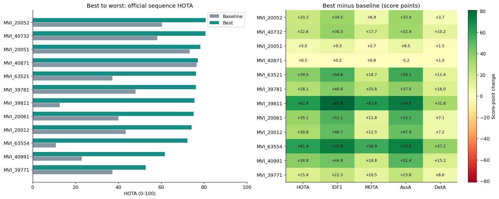
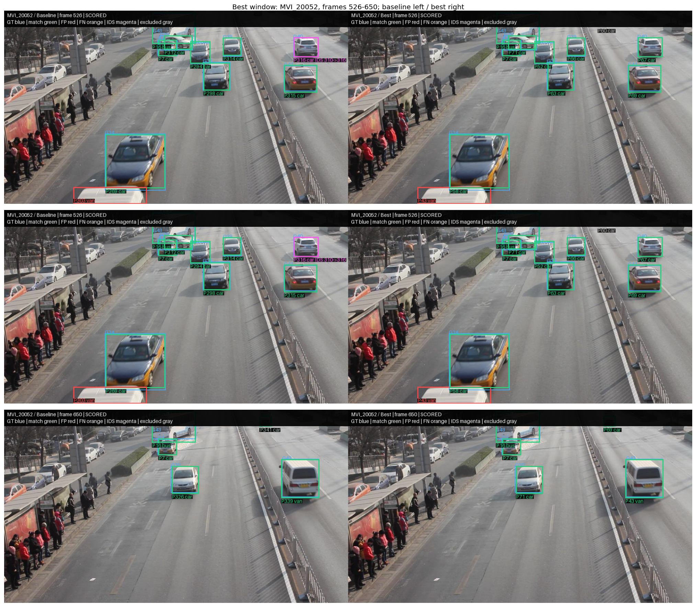
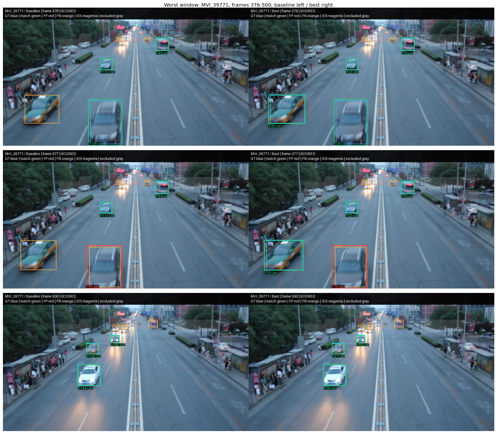
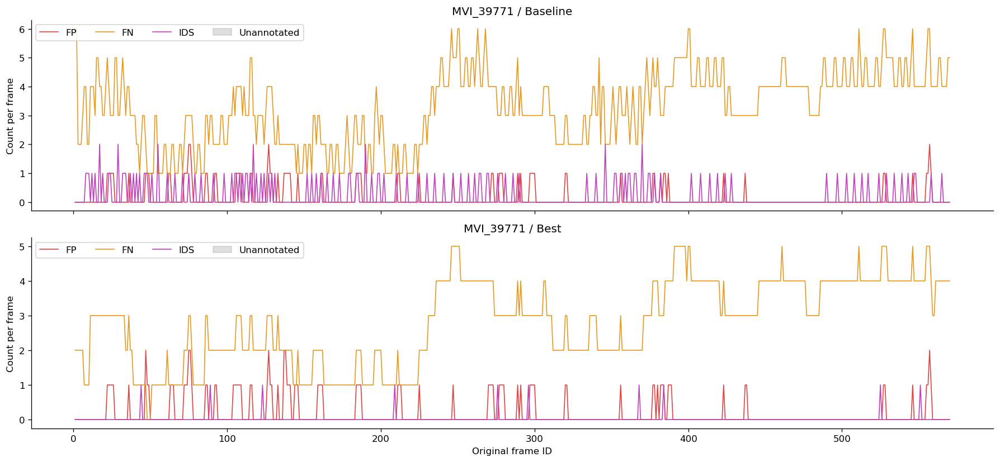
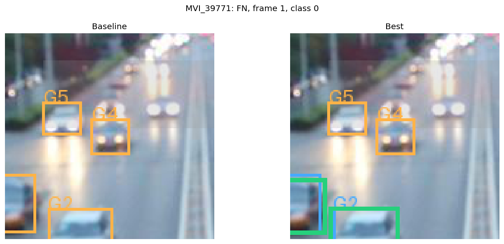
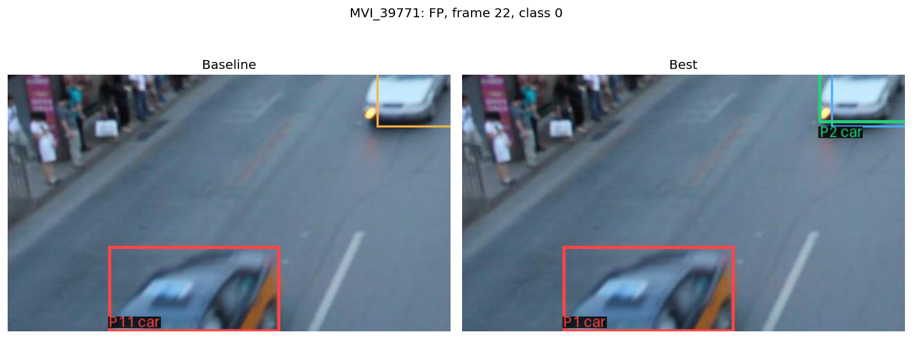
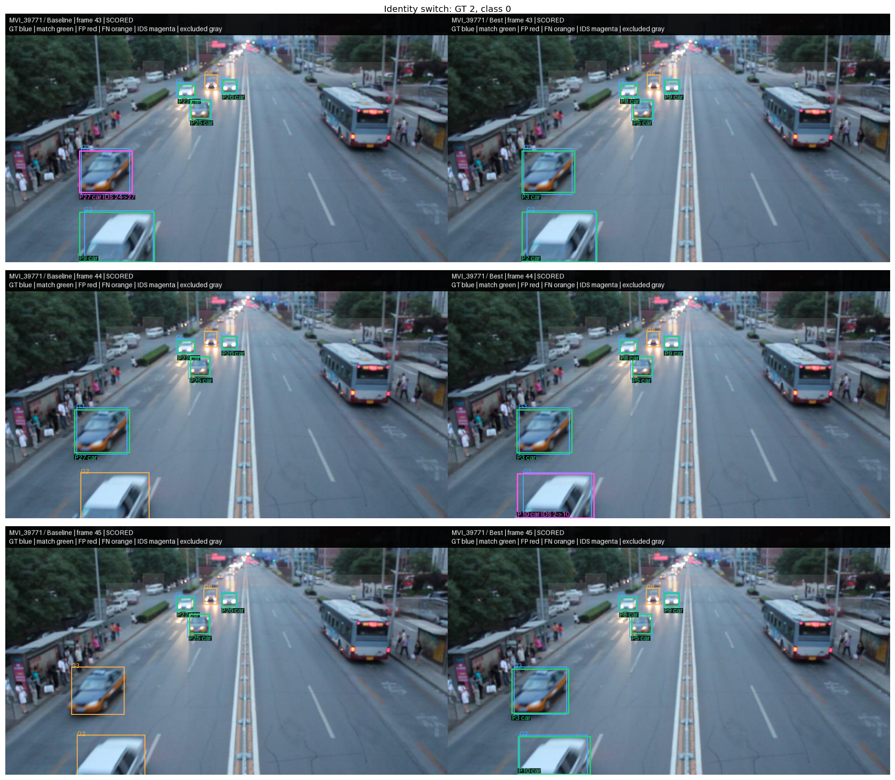
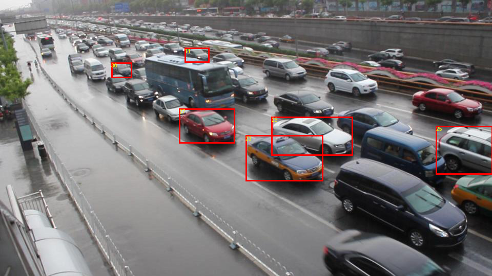

# Báo cáo phân tích lỗi UCMCTrack trên UA-DETRAC val

> Báo cáo này giữ nguyên bằng chứng và số liệu của protocol v1. Đợt sửa và
> chạy lại theo protocol v2 được ghi riêng trong
> [TRACKING_VAL_V2_REPORT.md](TRACKING_VAL_V2_REPORT.md). Không so sánh trực tiếp
> hai version như một mức cải thiện của tracker.
> Các thay đổi tracking tiếp theo và kết quả val mới nhất ở
> [TRACKING_REFINEMENT_V3_REPORT.md](TRACKING_REFINEMENT_V3_REPORT.md).
> Báo cáo này là mốc lịch sử; các giới hạn đã được xử lý sau đó không phải trạng thái hiện tại.

Ngày phân tích: 27/11/2026. Phạm vi: 12 sequence val, detector đã xuất CSV; không sử dụng test để đưa ra nhận định hoặc đề xuất tuning.

Kết quả hiện tại cải thiện mạnh việc giữ ID, nhưng các vấn đề còn lại gồm bỏ sót xe nhỏ/xa, nhầm class, prediction không có GT tương ứng ở biên ảnh và đổi ID khi xe đi ra khỏi khung hình. Ngoài ra, cần audit tương tác giữa GT và vùng ignore: một phần FN lớn ở `MVI_40871` có thể chịu ảnh hưởng của chính sách lọc prediction, không nên quy toàn bộ cho mô hình.

## 1. Nguồn bằng chứng và cách đọc

Thư mục nguồn: [`outputs/tracking/tuning_h_approved_v1/case_analysis`](../outputs/tracking/tuning_h_approved_v1/case_analysis/).

- Baseline: `70b585291d22758b`; cấu hình được chọn: `af8a55feaf077058`.
- Đọc `sequence_ranking.csv`, `selected_cases.csv`, `window_diagnostics.csv`, `gt_track_diagnostics.csv`, các file `*_events.csv` và `metric_count_checks.csv`; đối chiếu với summary/per-class của evaluator.
- Quan sát các ảnh best/worst window, close-up FP/FN, identity switch, identity timeline và error timeline. Các nhận định trực quan dựa trên những ảnh này, không phải đã xem thủ công toàn bộ video của 12 sequence.
- Kiểm tra bổ sung bbox GT từ bản xuất `tracking/<sequence>/gt/gt.txt`, prediction trong `tracks/*.csv`, detections nguồn và vùng ignore. Các phép đối chiếu bổ sung không thay đổi dữ liệu hay kết quả run.

FP/FN/IDS/Frag của phần chẩn đoán đã khớp evaluator cho **24 cặp sequence/run**. Matching class-aware: class 0 là `car` hợp lệ; CLEAR/Identity dùng IoU 0,7. HOTA dùng các ngưỡng 0,05–0,95. Chỉ frame có entry XML được chấm; frame chưa annotation không phải frame âm tính. Prediction chồng từ 50% diện tích nhìn thấy với **union vùng ignore** bị loại, GT không bị lọc thêm.

Một FP ở đây là prediction không được match theo protocol; không đồng nghĩa ảnh không có xe tại vị trí đó. FN cũng có thể do nhầm class, bbox chưa đạt IoU hoặc prediction bị loại bởi ignore, ngoài trường hợp detector không tìm thấy xe.

Các đoạn 5 giây được chọn trên lưới cửa sổ 125 frame, bước 25 frame, tối thiểu 30 GT observations và 80% frame có annotation. Điểm lỗi đoạn là `(FP + FN + IDS) / GT observations`; F1 đoạn và coverage của track **không phải HOTA/IDF1**. “Tốt nhất/xấu nhất” trong báo cáo chỉ nói đến các cửa sổ đủ điều kiện theo cách chọn này.

## 2. Toàn cảnh: association đã tốt hơn, detection còn là nút thắt

| Chỉ số tổng hợp TrackEval | Baseline | Cấu hình được chọn |
|---|---:|---:|
| HOTA | 57,29 | 75,86 |
| IDF1 | 54,38 | 84,63 |
| MOTA | 58,79 | 72,67 |
| AssA | 52,58 | 80,66 |
| DetA | 62,87 | 71,62 |
| IDS | 6.247 | 132 |
| FP | 8.517 | 11.456 |
| FN | 36.572 | 22.459 |
| Frag | 6.554 | 978 |

Đây là kết quả tổng hợp được lưu bởi evaluator, không phải trung bình HOTA của các video. Các score ở thang 0–100; các count là số nguyên. Kết quả là trên tập phát triển, không phải benchmark PR-MOTA nguyên bản của UA-DETRAC.

IDS giảm khoảng 97,9%, nhưng FP tăng khoảng 34,5%. Vì cấu hình được chọn thay đổi đồng thời confidence, motion parameters, HP và CMC, không thể chỉ từ bảng này kết luận riêng CMC hay HP gây ra toàn bộ cải thiện hoặc toàn bộ FP tăng thêm.

| Sequence đáng chú ý | HOTA | IDF1 | FP | FN | IDS | Vấn đề cần đọc cùng điểm số |
|---|---:|---:|---:|---:|---:|---|
| MVI_20052 | 80,69 | 91,32 | 855 | 474 | 1 | Sequence cao điểm nhất vẫn có prediction dư ở biên ảnh |
| MVI_40732 | 80,67 | 91,27 | 773 | 790 | 0 | Metadata là night nhưng kết quả tốt; không thể đồng nhất night với thất bại |
| MVI_40871 | 77,03 | 80,44 | 2.337 | 9.816 | 6 | Nhiều FN dù HOTA khá; cần audit ignore/GT |
| MVI_63554 | 72,26 | 81,02 | 1.974 | 1.530 | 47 | IDS cao nhất trong 12 sequence |
| MVI_63521 | 76,27 | 85,12 | 1.483 | 2.365 | 45 | IDS cao thứ hai; cùng MVI_63554 chiếm 92/132 IDS |
| MVI_40991 | 61,63 | 72,10 | 799 | 1.505 | 0 | Không đổi ID vẫn có thể HOTA thấp do detection/coverage |
| MVI_39771 | 52,72 | 69,65 | 99 | 1.580 | 10 | Sequence thấp điểm nhất; FN chiếm ưu thế |

Metadata weather/camera_state chỉ là bối cảnh. Chưa có phân tích kiểm soát mật độ, kích thước xe và coverage để kết luận quan hệ nhân quả.

## 3. Trường hợp tốt nhất: MVI_20052, frame 526–650

| Run | GT observations | TP | FP | FN | IDS | F1 đoạn | Điểm lỗi |
|---|---:|---:|---:|---:|---:|---:|---:|
| Baseline | 924 | 878 | 15 | 46 | 24 | 96,64% | 9,20% |
| Được chọn | 924 | 924 | 21 | 0 | 0 | 98,88% | 2,27% |

Cả 125 frame đều có annotation. Có thể xác nhận cấu hình được chọn match đủ 924 GT observations và giữ ID xuyên đoạn; baseline còn 46 FN và 24 IDS. Đây là ví dụ rõ về cải thiện tính liên tục, không phải chỉ cải thiện bbox ở một ảnh.

**Vấn đề vẫn còn:** 21 FP, gồm 9 `car` và 12 `van`. Tại frame 526, prediction `van P43` có confidence 0,213379 và bbox `(193,5; 493,75; 205; 46,25)`, nằm sát mép dưới ảnh. IoU lớn nhất với bất kỳ GT nào trong frame chỉ khoảng 0,030. Ảnh có một phần xe ở mép dưới, vì vậy nên mô tả là **prediction không có GT đủ điều kiện tương ứng**, chưa đủ bằng chứng gọi là phát hiện xe trên nền trống hoặc tự kết luận GT bị sai.

Xe chính trong cảnh được match tốt nhưng các đối tượng đi vào/ra biên ảnh vẫn gây FP. Bước tiếp theo là kiểm tra vòng đời P43, detections gốc và entry XML ở cùng thời điểm; không tự xóa các prediction biên ảnh chỉ để làm đẹp metric.

## 4. Trường hợp xấu nhất: MVI_39771, frame 376–500

| Run | GT observations | TP | FP | FN | IDS | F1 đoạn | Điểm lỗi |
|---|---:|---:|---:|---:|---:|---:|---:|
| Baseline | 699 | 199 | 8 | 500 | 10 | 43,93% | 74,11% |
| Được chọn | 699 | 226 | 12 | 473 | 1 | 48,24% | 69,53% |

Đoạn này cũng có đủ annotation. Run được chọn giảm mạnh IDS nhưng chỉ match 226/699 GT observations, tương đương recall đoạn khoảng **32,33%**. Như vậy giữ ID tốt hơn chưa giải quyết được việc bỏ sót đối tượng.

### 4.1. Xe nhỏ/xa và chất lượng detection nguồn

Ảnh cho thấy nhiều bbox cam ở phía xa, nơi xe nhỏ và có đèn/phản xạ sáng. Trong 473 FN observations, median bbox GT là **22,97 × 15,94 pixel**. Đây là thống kê mô tả, không phải lý do để loại các GT nhỏ khỏi evaluation.

Đối chiếu từng FN với **detections nguồn có confidence ≥ 0,05**, cùng frame:

| Candidate detection cùng class gần nhất | Số FN observations |
|---|---:|
| IoU ≥ 0,7 | 48 |
| 0,5 ≤ IoU < 0,7 | 29 |
| IoU < 0,5 hoặc không có candidate cùng class | 396 |
| Tổng | 473 |

396/473, khoảng **83,72%**, không có candidate cùng class đạt IoU 0,5. Do đó có bằng chứng trực tiếp rằng detections đã xuất là một nút thắt lớn trong đoạn này. Chưa phân biệt được detector hoàn toàn không phát hiện với detection dưới ngưỡng export 0,05, vì phần dưới ngưỡng không còn trong CSV.

Ngược lại, 48 FN vẫn có candidate cùng class đạt IoU 0,7 ở đầu vào: cần kiểm tra association, khởi tạo/xác nhận track, bbox đầu ra và cạnh tranh matching. Có candidate tốt chưa đảm bảo nó là một detection riêng khả dụng cho GT đó; phép kiểm tra này không thực hiện one-to-one assignment nên không được gọi 48 trường hợp này là “48 lỗi tracker đã chứng minh”.

Các GT đóng góp nhiều FN nhất trong đoạn: `bus G6` 117, `car G20` 86, `car G21` 86, `car G22` 55. Cần ưu tiên review theo các ID này thay vì chỉ xem một frame đông xe.

### 4.2. Nhầm class tạo cả FP và FN

Tại frame **377**, prediction `van P18` có IoU khoảng **0,8053** với GT `car G16`, confidence 0,592773. Tuy nhiên class khác nhau, nên evaluator ghi **FP cho van và FN cho car**. Đây là bằng chứng cụ thể của vấn đề class consistency; một bbox nhìn khá đúng trên overlay vẫn có thể thất bại trong đánh giá class-aware.

Vì pipeline chạy bốn tracker riêng, detection nhảy class có thể chuyển sang một không gian track khác. Cần xem chuỗi class/confidence của đối tượng qua nhiều frame trước khi thử class smoothing hoặc cơ chế association khác. Nếu thử, phải ghi thành biến thể mới; không đổi GT hay âm thầm chấm class-agnostic.

## 5. Các lỗi cận cảnh và identity switch

### 5.1. FN ở xe xa: MVI_39771, frame 1

`closeup_fn.png` cho thấy các xe nhỏ phía xa vẫn là bbox cam ở cả hai run, trong khi các xe gần đã được match tốt hơn ở run được chọn. Ảnh hỗ trợ nhận định về khó khăn ở vùng xa; nó không chứng minh riêng blur, đèn xe hoặc calibration là nguyên nhân duy nhất.

### 5.2. FP nhưng ảnh thực sự có xe: MVI_39771, frame 22

`car P1`, confidence **0,870605**, bbox `(95,25; 459; 162; 81)` nằm ở mép dưới ảnh và không giao bất kỳ bbox GT nào trong frame: max IoU **0**. Cả baseline và best đều vẽ prediction ở vùng xe đang ra khỏi ảnh.

Vì confidence khá cao, tăng threshold nhẹ chưa chắc xử lý được ca này. Cần đối chiếu XML và tiêu chí tồn tại GT khi xe ra biên. Báo cáo giữ nguyên cách tính FP hiện tại và không kết luận annotation bị thiếu/sai chỉ từ ảnh.

### 5.3. Đổi ID khi xe ra khỏi ảnh: MVI_39771, GT car G2

| Frame | Prediction được match với G2 | IoU | Sự kiện |
|---|---:|---:|---|
| 43 | P2 | 0,8808 | TP |
| 44 | P10 | 0,8669 | IDS: P2 → P10 |
| 45 | P10 | 0,9060 | TP |

GT G2 vẫn được match ở cả ba frame. Đây là **đổi danh tính thực sự theo protocol**, không phải mất match do IoU thấp ở frame 44. Ảnh cho thấy xe sát mép dưới; có thể cần kiểm tra truncation hình học, điểm đáy bbox và mapping mặt đất ở biên, nhưng chưa có log nội bộ để khẳng định nguyên nhân Kalman/association cụ thể.

Trên toàn bộ 46 observations của G2, baseline match 30, dùng 9 prediction IDs và có 8 IDS; best match đủ 46, dùng 2 IDs và có 1 IDS. Run được chọn cải thiện rất rõ nhưng chưa giữ một ID duy nhất đến cuối track. Trên biểu đồ identity timeline, các dấu FN của hai run cùng màu nên phải đọc cùng events CSV để tránh gán nhầm FN của baseline cho best.

## 6. Phát hiện cần audit: GT trong vùng ignore ở MVI_40871

Sequence này có HOTA 77,03 nhưng **9.816 FN**, khoảng 43,7% tổng 22.459 FN của best run. Track-level diagnostics cho thấy các trường hợp hoàn toàn không được match, dù tồn tại rất lâu:

| GT car | GT observations | Match | Giao vùng ignore ≥ 50% diện tích nhìn thấy |
|---|---:|---:|---:|
| G11 | 1.415 | 0 | 721 observations |
| G36 | 1.415 | 0 | 1.415 observations |

Hai track tồn tại từ frame 306 đến 1.720. Đối chiếu toàn bộ FN của sequence bằng cùng helper union ignore cho thấy **5.216/9.816 FN observations**, khoảng **53,14%**, có bbox GT nằm chủ yếu trong vùng ignore. Đây chỉ là phép đo chẩn đoán overlap; không áp dụng lọc GT vào evaluator.

Trong cùng cảnh, G23/G25/G26/G27 đều match đủ **1.720/1.720 observations**, mỗi GT dùng một prediction ID và không IDS. Không thể kết luận cả sequence là thất bại tracking; có sự khác biệt rất lớn giữa các đối tượng/vị trí.

Ảnh kiểm tra bổ sung tại frame 500 cho thấy G11/G36 ở xa hơn các xe được match ổn định phía trước:

**Vấn đề:** protocol đã chốt loại prediction theo ignore nhưng giữ nguyên mọi GT. Khi GT cũng nằm trong ignore, một prediction bám đúng GT có thể bị loại trước matching, trong khi GT đó vẫn đóng góp FN. Với G36, tình huống hình học này tồn tại ở mọi observation. Tuy vậy, thống kê overlap không chứng minh prediction thực tế tốt đã tồn tại ở tất cả những frame đó; không được coi 5.216 là số FN chắc chắn có thể phục hồi.

Ưu tiên đối chiếu ignored regions và GT với XML/cách sử dụng toolkit gốc. Giữ nguyên kết quả protocol v1 để có thể tái lập. Nếu quyết định thay đổi chính sách đánh giá sau audit, cần protocol version mới, rerun evaluation cho toàn bộ cấu hình cần so sánh và chọn lại cấu hình theo cùng protocol; không sửa riêng sequence khó hay xóa các GT này tùy ý.

## 7. Các giới hạn khi đọc kết quả

- `MVI_39811` chỉ chấm 500/1.070 frame, coverage 46,73%; `MVI_40991` chấm 1.667/1.820 frame, coverage 91,59%. Điểm số không xác nhận chất lượng ở các khoảng chưa annotation. Best có lần lượt 284 và 2 prediction observations trên những frame chưa chấm; chúng không tự động là FP.
- `bus` có HOTA 83,56; `car` 75,59; `van` 70,88; `others` 54,05. Cần review van/others riêng, nhưng chưa có phân tích đầy đủ sample size và class confusion để kết luận nguyên nhân chênh lệch.
- Hai sequence rainy MVI_63521/MVI_63554 tập trung khoảng 69,7% IDS. Đây là nơi nên tìm thêm ca lỗi, không phải bằng chứng mưa trực tiếp gây đổi ID.
- Bộ close-up lấy một ví dụ theo thứ tự events, không đại diện cho phân bố toàn bộ lỗi. Ảnh start/peak/end của đoạn tốt nhất có thể trùng frame khi cùng frame là peak; không xem đó là ba thời điểm độc lập.
- Không có chứng cứ đủ để kết luận calibration homography sai hoặc đúng tuyệt đối từ metric và overlay hiện tại. Kích thước mặt đường vẫn có giả định; cần log residual/mapping và ablation có kiểm soát nếu muốn quy lỗi cho calibration.

## 8. Thứ tự xử lý đề xuất

| Ưu tiên | Việc cần làm | Bằng chứng đầu vào | Tiêu chí kiểm tra |
|---|---|---|---|
| 1 | Audit GT–ignore trước khi tuning thêm | MVI_40871 G11/G36; 5.216 FN có overlap ignore cao | Xác nhận quy tắc từ XML/toolkit; công bố rõ protocol/version, giữ kết quả cũ |
| 2 | Phân tích detector ở xe nhỏ/xa | 396/473 FN của đoạn xấu không có detection cùng class IoU ≥ 0,5 | Chia theo kích thước/vị trí; đo candidate coverage, không chỉ đếm IDS |
| 3 | Kiểm tra class consistency | Frame 377: van P18 đối với car G16 | Theo dõi class qua thời gian; thử nghiệm riêng, báo cáo per-class FP/FN |
| 4 | Audit vòng đời track tại biên ảnh | FP frame 22; IDS G2 tại frame 44; FP van frame 526 | Log detection→association→track output, kiểm tra mapping đáy bbox và lý do tạo ID mới |
| 5 | Review IDS tập trung và FP tăng | MVI_63521/MVI_63554; toàn val FP tăng 34,5% | Dùng ablation đã lưu, đo trade-off HOTA/IDF1/FP/FN theo cùng protocol |

Không hạ confidence sweep dưới 0,05 với bộ CSV hiện tại vì dữ liệu dưới mức đó đã bị loại khi export. Muốn đo mức thấp hơn phải tạo detections mới và xem đó là một bộ đầu vào mới. Chưa thay đổi code tracking, calibration, annotation hay kết quả evaluation trong đợt phân tích này.
