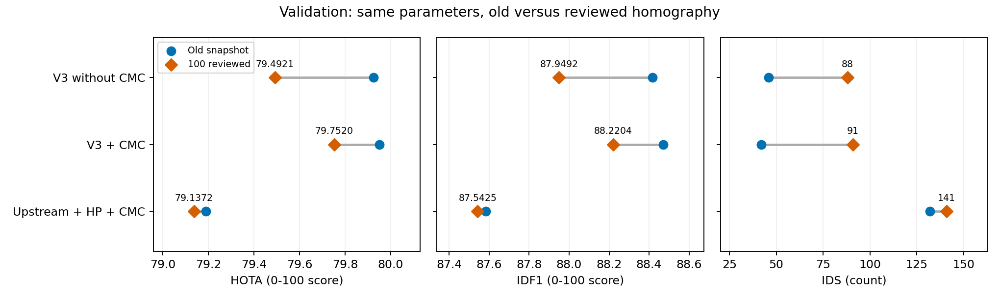
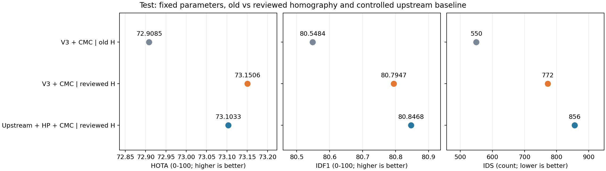
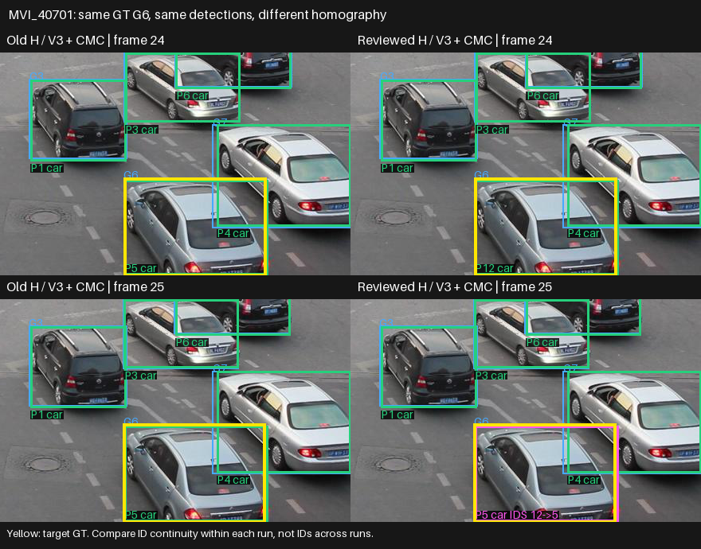

# Kết quả cuối với 100 homography đã reviewed

Ngày: 28/11/2026. Báo cáo này tách riêng calibration mới khỏi các mốc v2/v3 và
CMC trước đó; không ghi đè prediction, config hoặc metric lịch sử. Dùng detection
CSV đã xuất, không chạy lại YOLO.

Đã hoàn tất kiểm tra 100 camera, ba đối chứng trên 12 val sequences và hai
nhánh trên 40 test sequences. **V3 + CMC được chọn bằng val**. Với cùng homography
mới, nhánh này đạt test HOTA **73,1506**, cao hơn upstream **73,1033** một mức nhỏ;
IDF1 và MOTA thấp hơn upstream. Chi tiết cả cải thiện lẫn hồi quy được giữ bên dưới.

## Xác nhận calibration đã được cập nhật

`outputs/tracking/calibration/registry.json` đã có đủ **100/100 homography
reviewed hợp lệ**: 48 train, 12 val và 40 test. Kiểm tra bằng
`resolve_calibration(..., require_reviewed=True)`, bao gồm trạng thái, review
hash, ma trận, đơn vị và độ phân giải ảnh; không có lỗi.

Kiểm tra số học riêng cho cả 100 record xác nhận `A @ H` là identity sau chuẩn
hóa, và bốn góc ảnh/ground chiếu khớp nhau: sai số inverse lớn nhất
2,14 × 10⁻¹³, sai số ảnh 4,55 × 10⁻¹³ px, sai số ground 2,42 × 10⁻¹³ m.
Đây là kiểm tra tính nhất quán của dữ liệu đã lưu, không đo độ chính xác kích
thước ngoài thực địa. Registry có 57 rectangle 3,5 × 6 m; chiều dài các record
nằm trong khoảng 6–20 m. Nguồn/evidence của kích thước giữ theo người dùng khai
báo, không tự chuyển prior thành số đo thực tế.

Các lượt đối chứng trước dùng snapshot `registry_approved_h_v1.json` và
`test_calibration_draft/registry.json`, vì vậy **không tự dùng registry live mới**.
So với camera thực sự dùng trước đây, ma trận đã thay đổi ở **11/12 val** và
**36/40 test sequences**. Không suy biến đổi train từ dữ liệu so sánh thiếu camera
cũ. Danh sách chi tiết ở `cmc_v3/reviewed_100_inspection.csv`.

Snapshot được đóng băng cho lượt cuối:

```text
outputs/tracking/calibration/registry_reviewed_h100_7f16c297.json
SHA-256: 7f16c2970c776f852cf4c2ec9dd3ed797d60059645aa25667466fde3ac0ccfad
```

Giữ nguyên review/evidence của người dùng. Các thay đổi registry live sau thời
điểm snapshot không được âm thầm đưa vào giữa một lượt chạy. Toàn bộ run mới
enforce reviewed cameras, không dùng `--allow-unreviewed`.

## Thiết kế lượt chạy cuối

Chạy đủ 12 val sequences với ba nhánh, cùng homography mới:

1. V3 không CMC: sửa lifecycle, association chung, class voting offline,
   boundary sigma 10 px, HP bật.
2. V3 + CMC: chỉ thay công tắc CMC.
3. Upstream + HP + CMC: tracker/Kalman nguyên gốc, không sửa lifecycle, bốn
   tracker theo class và boundary sigma 0.

Giữ tham số số học của cấu hình trước: conf=0,05, high_score=0,60, a1=a2=40,
wx=wy=10, vmax=15, max_age=30, 25 FPS; interpolation tắt. Không sweep lại các
tham số này. Chọn cấu hình tốt nhất trong ba nhánh bằng **HOTA, IDF1, ít IDS hơn,
runtime thấp hơn khi hòa**, chỉ trên val mới. Đồng thời chọn v3 tốt nhất giữa
hai trạng thái CMC để so sánh với upstream trên test.

Khóa lựa chọn trước tracking 40 test sequences. Kết quả test cũ không được dùng
để quyết định bật/tắt CMC hoặc ưu tiên v3/upstream trong lần này. Test đã được
quan sát trong các vòng phát triển trước nên không gọi đây là lần đánh giá mù
đầu tiên. Không tuning thêm theo kết quả test mới.

Protocol vẫn là v2 của đồ án: class-aware, CLEAR/Identity IoU 0,7; HOTA dải chuẩn
0,05–0,95; ignore union đối xứng GT/prediction, chỉ chấm XML-declared frames và
giữ ID qua khoảng không annotation. Không lọc thêm GT theo kích thước, occlusion
hoặc truncation. Combine metric internals bằng TrackEval. Không phải PR-MOTA
nguyên bản UA-DETRAC.

## Kết quả val với homography mới: đủ 12/12 sequence

| Nhánh | HOTA | IDF1 | MOTA | AssA | DetA | IDS | FP | FN | Frag |
| --- | ---: | ---: | ---: | ---: | ---: | ---: | ---: | ---: | ---: |
| V3 không CMC | 79,4921 | 87,9492 | 77,3639 | 83,6020 | 75,8686 | 88 | 11.854 | 14.411 | 750 |
| **V3 + CMC: chọn** | **79,7520** | **88,2204** | **77,8148** | **83,7653** | **76,2156** | **91** | **11.592** | **14.145** | **748** |
| Upstream + HP + CMC | 79,1372 | 87,5425 | 77,6207 | 82,6043 | 76,1034 | 141 | 11.475 | 14.438 | 956 |



Trên cùng geometry mới, bật CMC tăng **0,2600 HOTA**, **0,2712 IDF1**, giảm
262 FP, 266 FN và 2 Frag, nhưng tăng 3 IDS. So với upstream cùng HP/CMC và
tham số số học, nhánh chọn tăng **0,6148 HOTA**, **0,6779 IDF1**, giảm 50 IDS
và 293 FN; FP tăng 117. Không quy tác động tổng hợp này riêng cho CMC.

So cùng cấu hình v3 + CMC giữa hai calibration, val thay đổi **79,9514 → 79,7520
HOTA**, **88,4705 → 88,2204 IDF1**, IDS **42 → 91**. Kết quả không chứng minh
review mới làm tăng điểm; cần giữ cả mức giảm này. Homography, kích thước rectangle
và phép truyền covariance đã đổi, còn tham số số học được giữ nguyên theo yêu
cầu tái chạy; chưa tune lại noise/gating theo geometry mới. Không khẳng định đó
là nguyên nhân duy nhất gây giảm score hoặc tự sửa camera theo metric.

`val_selection.json` chọn **v3_cmc** bằng val mới, trước test. Cấu hình cuối:

```text
conf=0.05, high_score=0.60, a1=a2=40, wx=wy=10,
vmax=15, max_age=30, fps=25, hp=true, cmc=true,
class_mode=shared_vote, boundary_sigma=10,
interpolation=false, fix_coasting=true
```

Nhánh không CMC không được chạy thêm trên test mới; đây là lựa chọn dựa trên
val, không dùng chênh lệch giữa camera cũ/mới làm đối chứng CMC trên test.

## Test v3 + CMC với homography mới: đủ 40/40 sequence

Đã chạy đủ 56.340 frame tracking, chấm 56.167 XML-declared frames. Nhánh chọn
đạt **HOTA 73,1506; IDF1 80,7947; MOTA 70,4748; AssA 78,3629; DetA 68,6160**,
với **772 IDS, 66.458 FP, 117.623 FN và 5.109 Frag**.

### Đối chứng với UCMCTrack gốc trên cùng 40 test sequences

| Nhánh | HOTA | IDF1 | MOTA | AssA | DetA | IDS | FP | FN | Frag |
| --- | ---: | ---: | ---: | ---: | ---: | ---: | ---: | ---: | ---: |
| **V3 + CMC: val-selected** | **73,1506** | 80,7947 | 70,4748 | **78,3629** | 68,6160 | **772** | 66.458 | **117.623** | **5.109** |
| Upstream + HP + CMC | 73,1033 | **80,8468** | **71,1212** | 77,8807 | **68,9495** | 856 | **61.221** | 118.729 | 6.612 |

V3 tăng **0,0473 HOTA**, **0,4822 AssA**, giảm **84 IDS, 1.106 FN và 1.503 Frag**;
đổi lại **5.237 FP tăng**, **IDF1 giảm 0,0521**, **MOTA giảm 0,6464**, DetA giảm
0,3335. Đây là kết quả đánh đổi, không phải V3 thắng mọi chỉ số hoặc chứng minh
mức tăng nhỏ có ý nghĩa thống kê. Baseline dùng core tracker/Kalman upstream,
cùng camera, HP/CMC và tham số số học đã tune, không phải bản tái lập điểm paper
với default tham số hoặc benchmark PR-MOTA.



Giữ nhánh phát hành đã chọn trên val; không đổi sang baseline theo IDF1/MOTA
test. Nhánh upstream vẫn được lưu đầy đủ để kiểm tra hoặc áp dụng tiêu chí khác
trong một thí nghiệm phát triển được định nghĩa trước.

So cùng cấu hình v3 + CMC với calibration cũ:

| Chỉ số | Homography cũ | 100 homography reviewed | Chênh lệch mới − cũ |
| --- | ---: | ---: | ---: |
| HOTA | 72,9085 | 73,1506 | +0,2420 |
| IDF1 | 80,5484 | 80,7947 | +0,2462 |
| MOTA | 70,1199 | 70,4748 | +0,3549 |
| AssA | 78,2548 | 78,3629 | +0,1080 |
| DetA | 68,2719 | 68,6160 | +0,3441 |
| IDS | 550 | 772 | **+222** |
| FP | 68.288 | 66.458 | −1.830 |
| FN | 118.237 | 117.623 | −614 |
| Frag | 4.920 | 5.109 | **+189** |

**HOTA/IDF1 tăng nhưng identity switches và fragmentations xấu hơn.** Không mô
tả kết quả là cải thiện đồng đều hoặc đã giải quyết mất ID. Giữ nguyên input
detection, evaluator và tham số số học; hash ảnh theo thứ tự mới đã được đối
chiếu khớp mốc cũ, còn số học mapper/CMC/Kalman/association không thay đổi.

### Lỗi còn lại theo class của nhánh chọn

| Class | HOTA | IDF1 | AssA | DetA | IDS | FP | FN |
| --- | ---: | ---: | ---: | ---: | ---: | ---: | ---: |
| car | 73,8699 | 82,2695 | 77,6952 | 70,5531 | 688 | 49.802 | 83.691 |
| bus | 78,0076 | 82,8273 | 83,8133 | 73,0769 | 60 | 10.347 | 9.727 |
| van | 63,4840 | 68,4004 | 76,2321 | 52,9858 | 18 | 5.854 | 12.046 |
| others | 41,8555 | 36,2382 | 76,3482 | 23,0030 | 6 | 455 | 12.159 |

`car` chiếm **688/772 IDS**, là nhóm cần tập trung khi phân tích lỗi giữ ID.
Macro-average qua bốn class đạt **HOTA 64,3043; IDF1 67,4338; MOTA 53,4746**,
thấp hơn kết quả combine chính. Count vẫn là tổng, không phải trung bình class.
Upstream có macro HOTA **63,1791**, IDF1 **67,2273**; V3 tốt hơn hai macro này
trong khi IDF1 combine chính thấp hơn nhẹ, do cách cân trọng số class khác nhau.
`van` và đặc biệt `others` có DetA thấp hơn nhiều AssA; cần tách lỗi thiếu
detection/class/localization khỏi lỗi nối track. Không coi FN đồng nghĩa detector
bỏ sót và không quy toàn bộ IDS tăng cho CMC: CMC bật ở cả hai lần, homography
mới làm đổi mapping/covariance và hành vi association với cùng tham số.

### Hồi quy ID tập trung ở hai sequence stable

| Sequence | Điều kiện | HOTA cũ → mới | IDS cũ → mới | FP mới − cũ | FN mới − cũ |
| --- | --- | ---: | ---: | ---: | ---: |
| MVI_40701 | cloudy, stable | 80,8126 → 67,4819 | 23 → 208 | −53 | +40 |
| MVI_40892 | rainy, stable | 58,6689 → 51,4683 | 3 → 220 | +1.058 | +79 |

Hai sequence này có **428/772 IDS (55,4%)**, tăng tổng cộng 402 so với camera
cũ; các sequence còn lại giảm tổng cộng 180 IDS. Vì vậy không mô tả việc tăng
IDS là suy giảm đồng đều trên toàn bộ test, hoặc gán mặc định cho camera rung.
Những nơi cải thiện rõ HOTA gồm `MVI_40902` (+5,7494), `MVI_40743` (+5,0350),
`MVI_40763` (+4,2885), `MVI_40903` (+3,9289) và `MVI_40762` (+3,4199).



Ví dụ được kiểm tra bằng matching CLEAR/IoU 0,7: tại `MVI_40701`, GT car **G6**
giữ **P5 → P5** ở frame **24 → 25** với camera cũ; camera mới đổi **P12 → P5**.
Số ID chỉ có ý nghĩa trong từng run. GT, bbox detection và cấu hình số học
giống nhau; đây là một quan sát đổi ID thực, không phải trace cost nội bộ để
kết luận chính xác lỗi bắt đầu tại bước gating, prediction hay birth nào.
Hai kết quả chẩn đoán full-sequence dùng dựng ảnh đều khớp evaluator tương ứng.

### Phân nhóm 117.623 FN theo candidate detector quan sát được

| Nhóm phân tích theo thứ tự ưu tiên | Số FN | Tỷ lệ |
| --- | ---: | ---: |
| Không có candidate cùng class đạt IoU 0,5 sau các nhóm ưu tiên | 61.045 | 51,90% |
| Candidate cùng class đạt IoU 0,5–0,7 | 23.794 | 20,23% |
| Có candidate cùng class IoU ≥ 0,7, được matching one-to-one ở audit detector | 16.481 | 14,01% |
| Candidate khác class đạt IoU ≥ 0,7 | 16.164 | 13,74% |
| Candidate cùng class IoU ≥ 0,7 nhưng bị cạnh tranh ở matching detector | 139 | 0,12% |

Các nhóm được gán tuần tự để không đếm trùng, tổng khớp FN evaluator. Nhóm
candidate tốt vẫn FN có thể liên quan birth/confirmation, association, class
voting hoặc xuất track; không quy toàn bộ 16.481 trường hợp cho một nguyên
nhân. Hai nhóm candidate yếu/không có candidate chiếm khoảng 72,1% FN trong
pipeline giữ bbox nguồn; đổi homography đơn thuần không sửa chất lượng bbox.
GT bị che khuất hoàn toàn vẫn nằm trong protocol hiện tại nên không tự gọi
mọi trường hợp không có candidate là lỗi detector nhìn thấy được.

`error_audit` được đối chiếu **FP/FN/IDS/Frag đúng cả 40/40 sequence** với evaluator;
`fn_category_summary.csv`, `test_old_new_homography_delta.csv` và
`ids_case_mvi40701.json` lưu bằng chứng để kiểm tra lại.

### Test easy / medium / hard của nhánh được chọn

Các nhóm được combine lại từ metric internals, không lấy trung bình điểm video.
Danh sách **Tracking toolkit** có 20 dòng medium nhưng chỉ 19 sequence duy nhất:
`MVI_40771` lặp và `MVI_40711` không thuộc nhóm nào. Giữ nhóm `unassigned` riêng,
không tự sửa danh sách gốc hoặc gộp lẫn với định nghĩa của Detection toolkit.

| Tracking difficulty | Sequences | HOTA | IDF1 | MOTA | IDS | FP | FN | Frag |
| --- | ---: | ---: | ---: | ---: | ---: | ---: | ---: | ---: |
| easy | 10 | 80,8861 | 89,5773 | 83,8503 | 218 | 11.360 | 8.403 | 422 |
| medium | 19 | 73,2801 | 81,6488 | 72,0121 | 417 | 30.235 | 66.389 | 2.894 |
| hard | 10 | 65,3803 | 70,3047 | 55,1668 | 137 | 23.928 | 42.727 | 1.788 |
| unassigned | 1 | 84,4793 | 92,6546 | 84,3924 | 0 | 935 | 104 | 5 |

Theo danh sách **Detection toolkit**, đủ 10/20/10 sequences, cùng output tracking
đạt kết quả dưới đây. Đây là cách phân nhóm khác, không phải kết quả detector
được chạy lại và không so trực tiếp easy của hai hệ định nghĩa với nhau.

| Detection difficulty | Sequences | HOTA | IDF1 | MOTA | IDS | FP | FN | Frag |
| --- | ---: | ---: | ---: | ---: | ---: | ---: | ---: | ---: |
| easy | 10 | 83,7547 | 91,4537 | 84,6001 | 38 | 8.305 | 7.982 | 272 |
| medium | 20 | 77,0868 | 86,2469 | 78,4023 | 311 | 26.445 | 29.098 | 1.935 |
| hard | 10 | 64,0238 | 70,1031 | 56,9070 | 423 | 31.708 | 80.543 | 2.902 |

Hard có DetA/FN kém hơn và cần xem cả chất lượng candidate lẫn association.
Tracking easy vẫn có 218 IDS, chủ yếu do hồi quy tại `MVI_40701`; tên nhóm easy
không bảo đảm mọi camera/tham số đều giữ ID tốt. CSV cuối lưu cả hai tracker và
cả hai hệ phân nhóm để đối chiếu.

So sánh HOTA với upstream trên cùng nhóm Tracking:

| Nhóm | V3 + CMC | Upstream + HP + CMC | V3 − upstream |
| --- | ---: | ---: | ---: |
| easy | 80,8861 | 80,4113 | +0,4747 |
| medium | 73,2801 | 73,1005 | +0,1796 |
| hard | 65,3803 | 65,9509 | **−0,5706** |
| unassigned | 84,4793 | 85,6658 | −1,1865 |

Trên hard, IDF1 cũng thấp hơn **70,3047 so với 71,1398** và FP nhiều hơn
**23.928 so với 21.199**. Vì vậy mức tăng HOTA tổng không chứng minh khả năng
xử lý cảnh khó đã tốt hơn upstream.

## Thay đổi code và cách chạy

| Phần | Vị trí | Lý do |
| --- | --- | --- |
| Registry rõ ràng, bất biến | [`finalize_reviewed_tracking.py`](../scripts/finalize_reviewed_tracking.py) | Bắt buộc truyền snapshot, kiểm tra đủ 100 reviewed cameras và nguồn trước/sau; không dùng nhầm snapshot cũ. |
| Chọn lại trạng thái CMC trên val mới | `candidate_configs`, `rank` trong script trên | Homography đổi đáng kể nên kiểm chứng lại lựa chọn trên cùng geometry mới, không chọn theo test. |
| Khóa test và output tốt nhất | `val_selection.json`, `test_selection_lock.json`, `completion.json` | Lưu cấu hình, calibration checksum và đường dẫn run được chọn; giữ baseline so sánh. |
| Hash ảnh song song | [`common.image_fingerprint`](../src/tracking/common.py), [`runner.py`](../src/tracking/runner.py) | Đọc SHA-256 bằng 4 thread, giữ thứ tự frame và thuật toán hash cũ. Không dùng shortcut size/mtime; file đổi nội dung dù cùng size/mtime vẫn bị phát hiện. Chỉ tối ưu preflight, không đổi số học tracking. |
| Regression | [`test_reviewed_final.py`](../tests/tracking/test_reviewed_final.py) | Kiểm tra candidate không retune tham số số học, reject calibration lock đổi và giữ fingerprint tương thích. |
| Metadata gói TrackEval | [`export_tracking_bundle.py`](../scripts/export_tracking_bundle.py) | README đọc trạng thái camera từ manifest; bỏ câu cố định 30 camera draft để không mô tả sai lượt reviewed mới. |

```powershell
python scripts/finalize_reviewed_tracking.py --calibration outputs/tracking/calibration/registry_reviewed_h100_7f16c297.json
```

Script chạy val → khóa lựa chọn → test → difficulty. Resume khi source/code/config
giống nhau; thay source thì dùng thư mục output mới. Artifact mặc định ở
`outputs/tracking/final_reviewed_h100`. Optical-flow cache được dùng lại vì không
phụ thuộc homography; loader vẫn hash ảnh/detection/code để kiểm tra tính hợp lệ.

## Hoàn tất, kiểm tra và bàn giao

`completion.json` xác nhận **complete**, 100 reviewed cameras, **59/59 source
files không đổi**, không chạy lại detector, chọn cấu hình chỉ trên val. Registry
live được kiểm tra lại khớp SHA-256 của snapshot đã dùng. Ba lượt val và hai lượt
test chạy local mất **3.148,10 giây (52 phút 28 giây)** tổng wall time.

| Lượt mới | Runtime pipeline | Evaluation | Wall time |
| --- | ---: | ---: | ---: |
| Val V3 không CMC | 91,76 s | 12,26 s | 107,16 s |
| Val V3 + CMC | 114,56 s | 23,40 s | 207,03 s |
| Val upstream + HP + CMC | 91,11 s | 17,64 s | 117,47 s |
| Test V3 + CMC | 952,49 s | 49,68 s | 1.250,10 s |
| Test upstream + HP + CMC | 1.219,39 s | 48,53 s | 1.462,02 s |

Wall time gồm hash/preflight; pipeline gồm các bước adapter/cache/mapping/
tracking/postprocess, không gồm YOLO. CMC dùng cache đã kiểm tra checksum;
chi phí tạo cache test trước đó khoảng 34,20 phút không nằm trong 52,47 phút
lượt reviewed mới. Runtime có ảnh hưởng I/O/cache/tải máy; không gọi đây là
benchmark realtime vì class voting thực hiện offline.

Đã có **33 regression tests phù hợp passed** (31 tracking/experiment và 2 export),
compile các module đã đổi và `git diff --check` không lỗi. Hash ảnh/detection cũ
và mới khớp ở đủ 52 val/test sequences; số học mapper/CMC/Kalman/association
không đổi trong lượt tái chạy này. Báo cáo lịch sử được giữ nguyên metric, bổ sung
liên kết và phân biệt rõ camera draft lịch sử với reviewed hiện tại.

Output được chọn:

- `outputs/tracking/final_reviewed_h100/best_config.yaml` và `val_selection.json`.
- `outputs/tracking/final_reviewed_h100/runs/val_v3_cmc` và `runs/test_v3_cmc`:
  CSV class-aware, MOT, manifest, metric từng sequence/class và runtime.
- `outputs/tracking/final_reviewed_h100/runs/test_upstream_hp_cmc`: đối chứng gốc.
- `test_difficulty.csv`, `error_audit`, `test_old_new_homography_delta.csv`:
  thống kê và bằng chứng lỗi; giữ count integer, score thang 0–100.
- `outputs/tracking/delivery_reviewed_h100/trackeval_bundle`: output val/test
  được chọn, GT/protocol/frame mapping/checksum cho evaluator dùng chung.

Gói TrackEval đã được chấm lại độc lập từ CSV và MOT tách class: **210/210
phép đối chiếu khớp**, gồm 2 kết quả tổng hợp và 208 cặp sequence/class.
Không cần ảnh hoặc chạy lại YOLO để chấm gói này. Không gộp score giữa các class
bằng trung bình HOTA video; dùng helper evaluator và protocol v2 đi kèm.

[Drive bàn giao của lượt cuối](https://drive.google.com/drive/folders/1_GFS4c8bxnWtCMJBxtj5RCmp5r4fcYZH)
chứa ba gói: `trackeval_selected_val_test`, `analysis_and_cameras`, `code`.
Archive giữ đường dẫn tương đối, có kiểm tra CRC và SHA-256 trong
`archives.json`/`SHA256SUMS.txt`. Gói analysis giữ cả các đối chứng kém hơn và
snapshot cũ/mới; không ghi đè các gói lịch sử. Gói code gồm upstream đã áp dụng
compatibility patch và snapshot camera/cấu hình đầu vào cần thiết; không có
dataset raw, ảnh hoặc trọng số detector.

## Hướng cải thiện tiếp theo sau khi khóa kết quả này

1. **Chẩn đoán geometry/noise trên val trước.** `MVI_63554` đã có IDS tăng
   **5 → 51** khi đổi calibration với cùng V3 + CMC; đây là ca phát triển có
   thể kiểm tra mà không tối ưu theo test. Lưu trace vị trí ground, Jacobian,
   covariance, innovation/gating và quyết định birth/match tại các chỗ đổi ID.
   Đối chiếu kích thước prior bằng mốc độc lập khi có dữ liệu; không chỉnh điểm
   hoặc scale chỉ để tăng metric. Nếu tune noise/gating, dùng ngân sách riêng
   và toàn bộ 12 val sequences với calibration đã khóa.
2. **Tách candidate tốt nhưng FN khỏi candidate yếu.** Với nhóm candidate tốt,
   truy lại lifecycle/confirmation/voting và quyết định xuất track. Với nhóm
   localization/class yếu, homography không tự sửa bbox; cần thí nghiệm detector
   hoặc hậu xử lý có đối chứng ở giai đoạn khác. Đợt này không chạy lại detection.
3. **Giữ báo cáo cân bằng class và identity.** Ngoài HOTA combine, theo dõi
   macro-average, `van`/`others`, IDS và Frag để tránh chỉ tối ưu `car` hoặc giảm
   FN bằng cách nối nhầm ID. Không đổi cấu hình phát hành sau khi đã xem test.

Review đủ homography đã hoàn tất; đối chứng H/KRT và frontend Colab thực chưa
được kiểm tra trong đợt này. Kích thước mặt đường là prior được người dùng ghi
nguồn, không phải calibration vật lý đã được đo thực địa.
