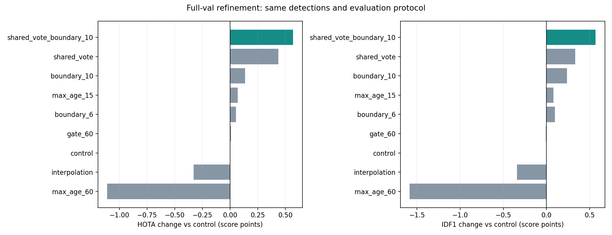
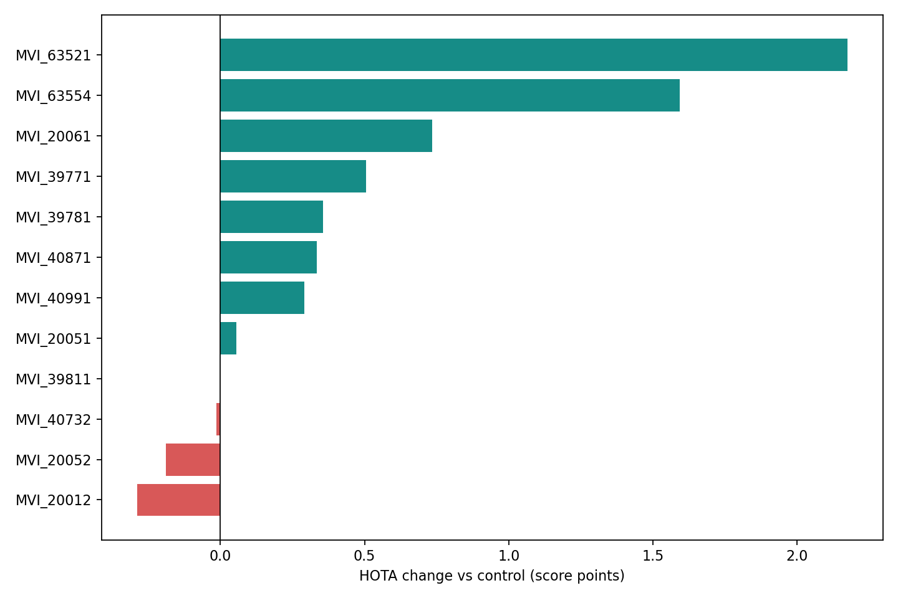
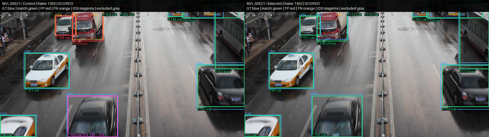
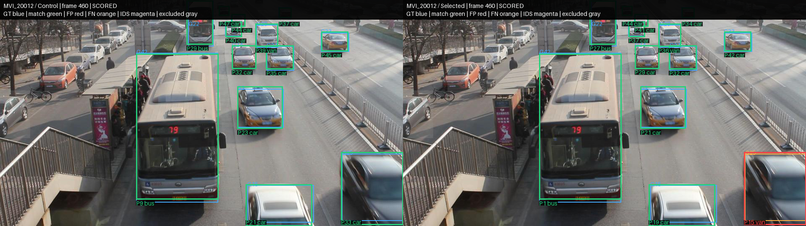

# Cải thiện tracking từ detection đã xuất: validation v3

> Đối chứng chỉ bật thêm CMC và so sánh upstream được ghi riêng trong
> [TRACKING_CMC_V3_REPORT.md](TRACKING_CMC_V3_REPORT.md). Các số liệu dưới đây
> giữ nguyên mốc v3 không CMC.

Ngày: 28/11/2026. Chạy local Windows, 12 val sequences, 16.001 frame tracking và
15.274 frame có annotation được chấm. Không chạy lại YOLO, không sửa detector,
canonical, split hoặc calibration val. Protocol vẫn là v2 của đồ án.

**Đã tăng:** HOTA **79,3543 → 79,9241** (+0,5698 điểm), IDF1
**87,8485 → 88,4183** (+0,5698 điểm), IDS **134 → 46** (giảm 65,7%).
Cấu hình chọn là `shared_vote_boundary_10`, dùng association chung, class voting
offline và uncertainty ở biên 10 pixel. FP tăng 180, FN giảm 551; không phải mọi
sequence đều cải thiện. Đây là điểm val dùng phát triển, chưa phải điểm test.

## 1. Tóm tắt thay đổi và định vị code

| Thay đổi | Vị trí | Động cơ và hành vi mới |
| --- | --- | --- |
| Noise có điều kiện ở biên ảnh | [`GroundMapper.mapto`](../src/tracking/detections.py#L152) | Trace trước cho thấy bbox bị cắt làm điểm đáy/covariance thiếu tin cậy. Đặt sàn độ lệch chuẩn trên trục ảnh bị cắt, rồi truyền qua Jacobian homography; giữ nguyên bbox và điểm đáy giữa. |
| Association chung nhiều class, tùy chọn | [`run_tracking`: khởi tạo tracker](../src/tracking/runner.py#L306) | Bốn tracker riêng không thể nối cùng xe khi detector đổi class. `shared_vote` dùng một tracker cho mọi class, giữ Kalman và assignment cost của upstream. |
| Class ổn định theo track | [`tích lũy vote`](../src/tracking/runner.py#L395), [`chốt class`](../src/tracking/runner.py#L510) | Tổng confidence của các detection được gán quyết định class của cả track; không sử dụng GT. Lưu vote để audit. Đây là offline, không được báo như realtime không độ trễ. |
| Mặc định giữ hành vi cũ | [`BASELINE`, `resolve_config`](../src/tracking/common.py#L14) | `boundary_sigma=0`, `class_mode=separate`. Tính năng mới phải bật rõ trong YAML; config tham gia fingerprint/resume. |
| Đối chứng có thể chạy lại | [`scripts/refine_tracking.py`](../scripts/refine_tracking.py#L26) | Chạy hữu hạn 9 lượt full-val: 1 tái lập và 8 biến thể. Ghi config, metric, checksum, log; chọn theo HOTA, IDF1, IDS, runtime. |
| Regression cho logic mới | [`test_refinements.py`](../tests/tracking/test_refinements.py) | Kiểm tra noise theo đúng trục, không đổi điểm/bbox; giữ ID qua class flicker; hai xe không trùng ID; giữ timeline rỗng, source CSV và resume. |

Biên được xác định khi bbox cách trái/phải hoặc đáy ảnh không quá 2 pixel. Chạm
trái/phải tăng uncertainty trục x, chạm đáy tăng trục y; không tăng noise cho bbox
ở trong ảnh. Sàn thử là 6 hoặc 10 pixel. Đây là heuristic được thử trên val, không
phải công thức noise mới được chứng minh trong paper.

Class voting dùng tổng top-1 confidence, không phải phân phối xác suất class đã
calibrate. Mỗi detection đã gán đóng góp một lần; class có tổng lớn nhất được
chọn, hòa chọn class ID nhỏ hơn. Các quan sát Tentative còn tồn tại cũng đóng
góp vote; HP chỉ xuất phần đầu của track sau khi track được xác nhận. Vote dùng
cả frame tương lai và frame không có XML; evaluator vẫn chỉ chấm frame có XML.

## 2. Đối chứng và các giới hạn được giữ cố định

Đối chứng là `validation_v2/runs/coasting_fix_hp`, đã sửa lifecycle, HP bật, CMC
và interpolation tắt. Mọi lượt dùng `fix_coasting=True`, conf 0,05, high_score
0,60, wx=wy=10, vmax=15, FPS=25; a1=a2=40 và max_age=30 trừ lượt thử tương ứng.

Run `control` tái lập prediction **đúng từng byte trên đủ 12 sequences**. HOTA,
IDF1 và các count cũng trùng bản đã lưu. Không dùng điểm protocol v1 làm baseline.
Protocol v2 lọc GT/prediction theo cùng union ignore; CLEAR/Identity IoU 0,7,
HOTA 0,05–0,95. Không lọc GT theo size, truncation hoặc occlusion.

[`preservation_check.json`](../outputs/tracking/refinement_v3/preservation_check.json)
xác nhận 30 file đầu vào/tham chiếu không đổi: 12 CSV detection, handoff,
calibration, 4 file canonical/metadata và 12 CSV tracking lịch sử. Đây là kiểm tra
các file được liệt kê, không phải đã hash lại mọi ảnh raw.

## 3. Kết quả đủ 12 val sequences

| Lượt | HOTA | IDF1 | FP | FN | IDS | Frag |
| --- | ---: | ---: | ---: | ---: | ---: | ---: |
| Đối chứng v2 | 79,3543 | 87,8485 | 11.429 | 14.421 | 134 | 972 |
| Biên, sigma 6 | 79,4060 | 87,9447 | 11.403 | 14.419 | 103 | 971 |
| Biên, sigma 10 | 79,4889 | 88,0852 | 11.436 | 14.410 | 59 | 972 |
| Association chung + voting | 79,7892 | 88,1832 | 11.590 | 13.876 | 119 | 781 |
| **Chung + voting + biên 10** | **79,9241** | **88,4183** | **11.609** | **13.870** | **46** | **783** |
| Interpolation | 79,0239 | 87,5081 | 13.516 | 13.438 | 126 | 626 |
| max_age 15 | 79,4222 | 87,9291 | 11.315 | 14.495 | 124 | 952 |
| max_age 60 | 78,2436 | 86,2630 | 11.794 | 13.965 | 173 | 1.038 |
| a1=a2=60 | 79,3622 | 87,8404 | 11.471 | 14.403 | 74 | 970 |

Score ở thang 0–100, count là số nguyên. HOTA chính được tổng hợp bằng hàm
combine của TrackEval, không phải trung bình HOTA các video. Cấu hình chọn có
MOTA 78,0751, AssA 83,8585, DetA 76,4598; macro HOTA 78,2749.



Thử biên riêng cho thấy IDS giảm 134→59 với HOTA tăng 0,1347. Nhánh chung/voting
riêng tăng HOTA 0,4349; khi thêm biên 10, HOTA tăng tiếp 0,1349 và IDS 119→46.
Không tách riêng được tác dụng của association chung và voting từ hai lượt này
vì chúng là một nhánh kết hợp. Không kết luận toàn bộ cải thiện đến từ voting.

Interpolation giảm FN/Frag nhưng tăng 2.087 FP và giảm HOTA. max_age=60 tăng IDS
và làm HOTA giảm rõ. max_age=15 và gate=60 có cải thiện nhỏ ở một số chỉ số nhưng
không thắng nhánh được chọn; không tự ghép thêm chúng nếu chưa có đối chứng.

## 4. Class nào và sequence nào tốt hơn, xấu hơn?

| Class | HOTA đối chứng | HOTA mới | Thay đổi FP | Thay đổi FN | IDS cũ → mới |
| --- | ---: | ---: | ---: | ---: | ---: |
| car | 78,9381 | 79,2894 | +68 | −17 | 121 → 43 |
| bus | 85,5283 | 86,5092 | −79 | −110 | 7 → 1 |
| van | 77,2500 | 78,7662 | +178 | −343 | 6 → 2 |
| others | 55,6553 | 68,5349 | +13 | −81 | 0 → 0 |

`others` có mức tăng lớn nhưng ít observations hơn car; không coi đây là nhiều
mẫu xe độc lập. Cả bốn class tăng HOTA nhưng FP van tăng, và DetA car giảm nhẹ
0,0172 điểm. Nhánh mới không giải quyết hết lỗi phân loại hoặc localization.

Trong 12 sequence, **8 tăng HOTA, 3 giảm, 1 giữ nguyên**:

| Sequence | HOTA cũ → mới | IDS cũ → mới | Diễn giải |
| --- | ---: | ---: | --- |
| MVI_63521 | 76,3494 → 78,5238 | 44 → 27 | Tăng lớn nhất; FP giảm 134, FN giảm 242. |
| MVI_63554 | 72,2032 → 73,7954 | 50 → 6 | Giảm mạnh đổi ID; FP vẫn tăng 56. |
| MVI_39771 | 61,4405 → 61,9450 | 10 → 0 | Giữ ID tốt hơn; FN vẫn 990. |
| MVI_40871 | 84,1193 → 84,4548 | 6 → 4 | FN giảm 172 nhưng vẫn 4.427, còn là nguồn FN lớn. |
| MVI_20012 | 77,6992 → 77,4101 | 3 → 2 | HOTA giảm 0,2891; FP +37, FN +9. |
| MVI_20052 | 82,0693 → 81,8815 | 1 → 1 | HOTA giảm 0,1878; FP +41, FN +33. |
| MVI_40732 | 81,7813 → 81,7679 | 0 → 0 | Giảm nhẹ 0,0134; FP +46. |



Các ảnh dưới chọn frame có mức thay đổi count lớn nhất trong sequence, không
đại diện cho toàn video; trái là đối chứng, phải là nhánh chọn. Count tại frame
là chẩn đoán CLEAR, không phải HOTA của đoạn.

- `MVI_63521`, frame 1420: FP/FN/IDS **2/3/1 → 0/1/0**.
- `MVI_20012`, frame 460: **0/0/0 → 1/1/0**, minh họa regression cần giữ trong báo cáo.
- `MVI_40991`, frame 1: **1/1/0 → 0/0/0**; toàn sequence chỉ tăng HOTA 0,2907.

Quan sát frame 1420 của MVI_63521: xe trắng phía trên trái trước bị xuất là van
được nhánh mới xuất là car; xe tải đỏ trước bị xuất là bus được xuất là others,
hai cặp này trở thành match đúng class. Xe car sát đáy ảnh còn tránh được sự kiện
đổi ID của đối chứng. Ngược lại, tại MVI_20012 frame 460, xe sát góc dưới phải
được đối chứng xuất car nhưng nhánh mới xuất van, tạo FP/FN. Đây là ví dụ cụ thể
về lợi ích và rủi ro của nhánh association/voting, không phải bằng chứng voting
luôn sửa đúng mọi nhãn hoặc một thành phần riêng gây toàn bộ thay đổi.




Chẩn đoán FP/FN/IDS/Frag đã khớp evaluator ở **24 cặp sequence/run**. Audit bbox
của nhánh chọn kiểm tra **129.199 rows**: tất cả có bbox/confidence tương ứng
trong detection nguồn, so tọa độ làm tròn 6 chữ số; **2.249 rows đổi class**.
Đây là kiểm tra bảo toàn nguồn hình học, không chứng minh bbox đúng với GT.

## 5. Artifact, thời gian và chạy lại

- Output thắng: [`runs/shared_vote_boundary_10`](../outputs/tracking/refinement_v3/runs/shared_vote_boundary_10/).
- [`leaderboard.csv`](../outputs/tracking/refinement_v3/leaderboard.csv), config từng lượt, run manifest, per-sequence/per-class, metric internals và protocol đều được lưu.
- [`best_val_v3.yaml`](../configs/tracking/best_val_v3.yaml) dùng cùng flag `--fix-coasting`.
- [`per_sequence_comparison.csv`](../outputs/tracking/refinement_v3/per_sequence_comparison.csv), [`per_class_comparison.csv`](../outputs/tracking/refinement_v3/per_class_comparison.csv) và [`case_evidence.csv`](../outputs/tracking/refinement_v3/case_evidence.csv) chứa số liệu chi tiết.

Nhánh chọn ghi nhận 288,05 giây tracking/adapter/postprocess và 77,52 giây đánh
giá. Đối chứng lần này là 239,84 và 63,04 giây. Một số lượt chạy song song nên
đây là thời gian quan sát, không phải phép đo speedup có kiểm soát. Log chính
chạy khoảng 30 phút 32 giây cho cả lịch. Thời gian không bao gồm inference YOLO.

```powershell
python scripts/refine_tracking.py
python scripts/tracking_pipeline.py run --config configs/tracking/best_val_v3.yaml --calibration outputs/tracking/calibration/registry_approved_h_v1.json --fix-coasting --output outputs/tracking/run_best_val_v3
python scripts/tracking_pipeline.py evaluate --output outputs/tracking/run_best_val_v3
```

Nếu code/input đã thay đổi so với manifest, chọn output mới thay vì sửa
fingerprint để ép resume. Các output lịch sử được giữ để đối chiếu.

## 6. Giới hạn và bước test

Noise ở biên là heuristic, camera vẫn dựa trên kích thước prior; voting dùng
tương lai và có thể gộp nhầm xe hoặc cố định một class sai. Detector chưa được
cải thiện nên xe thiếu detection và bbox chưa đạt IoU vẫn là giới hạn chính.
Không cam kết mức tăng val sẽ lặp lại trên test.

Cấu hình trên được khóa trước khi chạy test; không tuning lại theo metric test.
Kết quả, difficulty và trạng thái calibration test được ghi riêng trong
[`TRACKING_TEST_V3_REPORT.md`](TRACKING_TEST_V3_REPORT.md). Rà soát các báo cáo
trước nằm trong [`TRACKING_REPORT_AUDIT.md`](TRACKING_REPORT_AUDIT.md).
