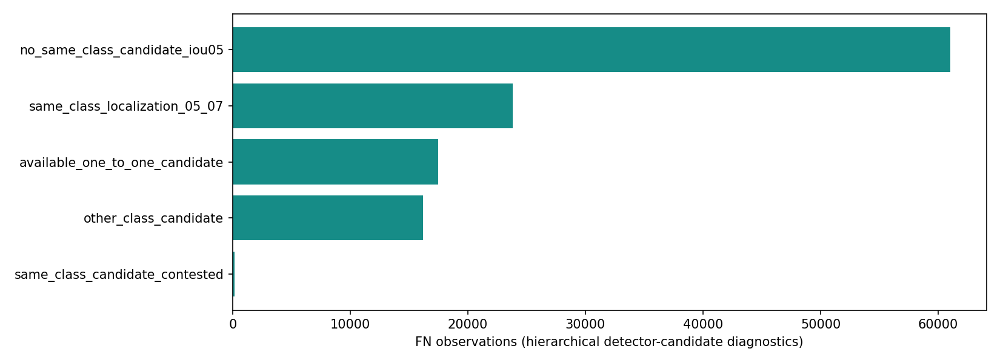
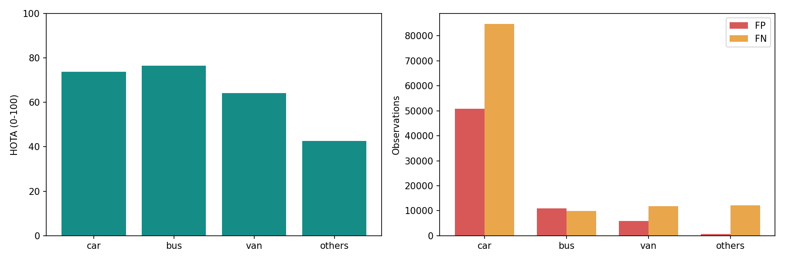
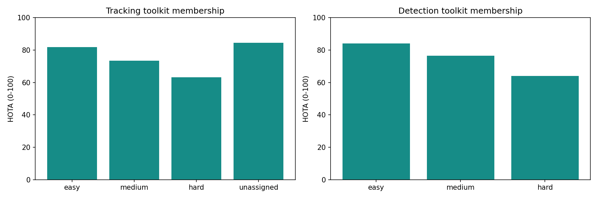
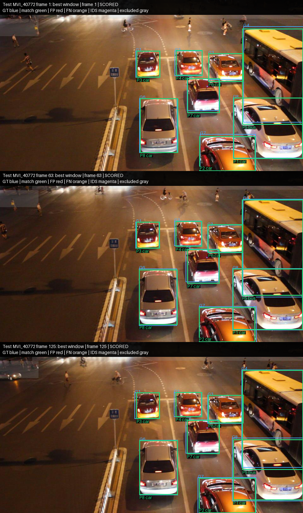
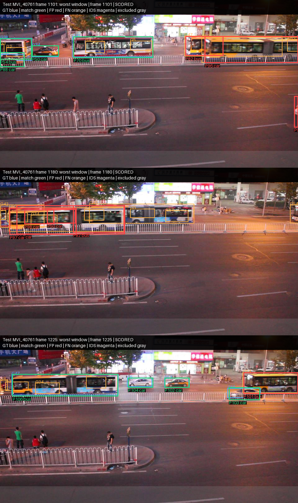
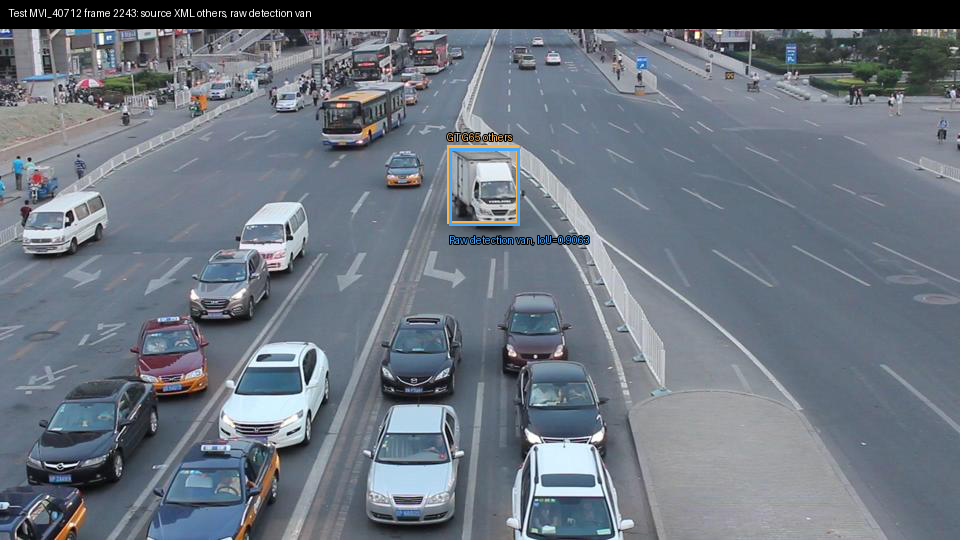
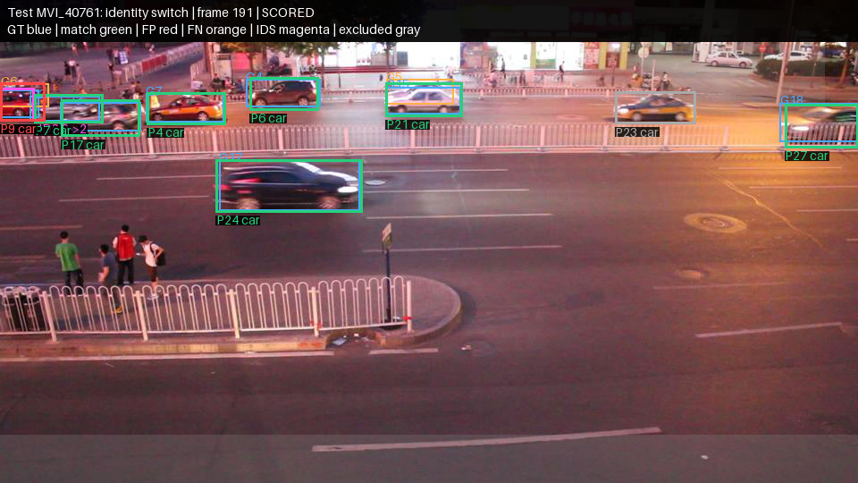

# Đánh giá UCMCTrack v3 trên test UA-DETRAC

Ngày: 28/11/2026. Đã chạy và chấm đủ **40 test sequences**, 56.340 frame tracking,
56.167 frame có annotation; không chạy lại detector hoặc tuning theo test.

**HOTA 72,8970; IDF1 80,5637; MOTA 70,0346; IDS 542.** Kết quả dùng cấu hình
được chọn trên val, với **30/40 camera còn draft** nên vẫn provisional về hình học
camera. Không coi chênh lệch điểm val/test là một phép đo cải thiện cùng dữ liệu.

## Tóm tắt thay đổi phục vụ lần test này

| Phần | Định vị | Động cơ và giới hạn |
| --- | --- | --- |
| Khóa lựa chọn từ val | [`run_tracking_test.py`](../scripts/run_tracking_test.py#L26), [`best_val_v3.yaml`](../configs/tracking/best_val_v3.yaml) | Ghi selection/input/protocol trước tracking; không chọn hoặc tuning cấu hình theo test. |
| Calibration test còn thiếu | [`test_camera_drafts.json`](../configs/tracking/test_camera_drafts.json), [`prepare_test_cameras.py`](../scripts/prepare_test_cameras.py#L21) | Registry cũ chỉ có 10 camera test reviewed; bổ sung 30 proposal riêng dựa trên ảnh, không sửa registry cũ và không giả mạo review. |
| Phân nhóm difficulty | [`difficulty_lists`](../src/tracking/subsets.py#L14) | Đọc danh sách toolkit, loại duplicate cùng nhóm nhưng công bố lỗi nguồn và giữ nhóm unassigned. |
| Tổng hợp metric nhóm | [`aggregate_saved`](../src/tracking/subsets.py#L38) | Combine metric internals bằng TrackEval, giữ dải threshold HOTA; không lấy trung bình score từng video. |
| Audit lỗi/candidate detector | [`audit_tracking_detections.py`](../scripts/audit_tracking_detections.py), [`audit_tracking_errors.py`](../scripts/audit_tracking_errors.py), [`analyze_tracking_test.py`](../scripts/analyze_tracking_test.py) | Tái sử dụng helper đã kiểm thử, kiểm tra count chẩn đoán so với evaluator trước khi giải thích FN/FP/IDS. |
| Gói đánh giá dùng chung | [`export_tracking_bundle.py`](../scripts/export_tracking_bundle.py) | Giữ CSV class-aware và frame gốc, đồng thời xuất MOT tách class/compact frame, có ignore policy và mapping. Giữ nguyên chuỗi số GT khi xuất để tránh làm lệch tie tại ngưỡng IoU. |

## Protocol và chất lượng calibration

Cấu hình chọn trên val là `shared_vote_boundary_10`: conf=0,05, high_score=0,60,
a1=a2=40, wx=wy=10, vmax=15, max_age=30, FPS=25; HP và lifecycle fix bật,
association chung + voting offline, sigma biên=10 pixel, CMC/interpolation tắt.
Không chạy lại YOLO/NMS, không thay detection nguồn hoặc dùng test để chọn tham số.

Giữ protocol v2: tracking đủ timeline 25 FPS; chỉ chấm frame XML khai báo, kể cả
entry XML rỗng. Loại GT/prediction theo cùng union ignore ở ngưỡng 50% diện tích
nhìn thấy. CLEAR/Identity IoU 0,7; HOTA 0,05–0,95; combine của TrackEval. Không
lọc GT theo size, occlusion hoặc truncation; không phải PR-MOTA nguyên bản.

**Giới hạn quan trọng:** chỉ 10/40 calibration test đã có review. 30 proposal mới
khởi tạo bằng cách quan sát ảnh đầu và chọn tứ giác mặt đường, width=3,5 m,
length=12 m đều là prior chưa đo. Đã xuất preview đầu/giữa/cuối, vẫn giữ `draft`.
Kết quả test là **provisional về chất lượng hình học camera**, không phải nghiệm
thu gói calibration đầy đủ. Không dùng GT/metric test để đặt hoặc chỉnh các điểm.

## Danh sách difficulty gốc

- Tracking toolkit: easy 10 ID, medium 20 dòng nhưng chỉ 19 ID duy nhất do
  `MVI_40771` lặp; hard 10 ID. `MVI_40711` thiếu khỏi cả ba danh sách và được báo
  trong nhóm `unassigned`, không tự gán vào medium.
- Detection toolkit: có đủ 10/20/10 ID, phủ đủ 40 test sequences; cách chia khác
  Tracking, được báo riêng và không đổi nhãn thành “tracking difficulty”.
- Nguồn và checksum của từng file được lưu trong `selection_lock.json`.

## Kết quả toàn test và từng class

| Chỉ số | Giá trị |
| --- | ---: |
| HOTA | 72,8970 |
| IDF1 | 80,5637 |
| MOTA | 70,0346 |
| AssA | 78,3183 |
| DetA | 68,1945 |
| FP | 68.431 |
| FN | 118.636 |
| IDS | 542 |
| Frag | 4.913 |
| Macro HOTA / IDF1 | 64,2415 / 67,9884 |

Score ở thang 0–100; count là observations/sự kiện theo metric, không phải số xe
độc lập. Tập được chấm có **626.085 GT observations** sau ignore; 49.689 GT và
165.260 predictions bị loại theo cùng policy ignore. Có 418 predictions ở frame
chưa annotation, không được tính như FP. Raw/canonical và detection nguồn giữ nguyên.

| Class | GT observations | HOTA | IDF1 | AssA | DetA | FP | FN | IDS |
| --- | ---: | ---: | ---: | ---: | ---: | ---: | ---: | ---: |
| car | 509.782 | 73,7128 | 81,9332 | 77,8036 | 70,1709 | 50.858 | 84.761 | 415 |
| bus | 64.904 | 76,5123 | 82,2475 | 81,7059 | 72,1542 | 10.964 | 9.855 | 116 |
| van | 35.185 | 64,1836 | 70,1708 | 78,1042 | 52,8626 | 5.958 | 11.908 | 8 |
| others | 16.214 | 42,5575 | 37,6019 | 78,8561 | 23,0129 | 651 | 12.112 | 3 |

`others` còn yếu dù AssA khá cao: DetA thấp và FN chiếm khoảng 74,7% GT observations.
AssA cao trên phần đã match không có nghĩa hầu hết xe đã được theo dõi đúng.
Macro score thấp hơn score chính cho thấy cần đọc cả các class ít phổ biến.

## Easy, medium, hard

### Theo danh sách Tracking toolkit

| Nhóm | Sequences | HOTA | IDF1 | MOTA | FP | FN | IDS |
| --- | ---: | ---: | ---: | ---: | ---: | ---: | ---: |
| Easy | 10 | 81,8581 | 90,4693 | 83,5909 | 11.482 | 8.790 | 30 |
| Medium, ID duy nhất | 19 | 73,3365 | 81,8300 | 71,8740 | 30.342 | 66.889 | 289 |
| Hard | 10 | 63,2128 | 68,1680 | 53,8559 | 25.669 | 42.853 | 223 |
| Unassigned: MVI_40711 | 1 | 84,4459 | 92,6350 | 84,3473 | 938 | 104 | 0 |

Nguồn: `data/raw/Toolkit/DETRAC-Test-Tra/evaluation/seqs/testlist-{easy,medium,hard}.txt`.
Bốn nhóm phủ đủ 40 sequences, không đếm MVI_40771 hai lần. GT observations của
easy/medium/hard/unassigned lần lượt 123.724 / 346.725 / 148.979 / 6.657.

### Theo danh sách Detection toolkit, cách chia khác

| Nhóm | Sequences | HOTA | IDF1 | MOTA | FP | FN | IDS |
| --- | ---: | ---: | ---: | ---: | ---: | ---: | ---: |
| Easy | 10 | 84,1055 | 91,8340 | 84,9302 | 7.905 | 8.017 | 53 |
| Medium | 20 | 76,4075 | 85,1058 | 77,5354 | 27.889 | 29.999 | 208 |
| Hard | 10 | 64,0011 | 70,6094 | 56,5765 | 32.637 | 80.620 | 281 |

Nguồn: `data/raw/Toolkit/DETRAC-Test-Det/evaluation/seqs/testlist-{easy,medium,hard}.txt`.
Không trộn hai cách chia hoặc thay số của nhóm này vào nhóm kia. Toàn bộ metric
nhóm được combine lại từ `metrics.json`; combine đủ 40 tái tạo đúng kết quả toàn
test. `difficulty_summary.csv` còn có AssA/DetA/Frag, frame count và GT count.

## Các sequence cần ưu tiên đọc lỗi

| Sequence | Cảnh theo metadata | HOTA | FP | FN | IDS |
| --- | --- | ---: | ---: | ---: | ---: |
| MVI_40761 | Night, unstable | 46,4038 | 3.532 | 7.249 | 78 |
| MVI_39501 | Cloudy, stable | 54,2413 | 838 | 1.939 | 2 |
| MVI_40864 | Rainy, stable | 55,7219 | 2.312 | 16.712 | 45 |
| MVI_40762 | Night | 57,5163 | 1.402 | 3.828 | 25 |
| MVI_40892 | Rainy, stable | 58,7448 | 3.839 | 10.557 | 3 |

MVI_40864 có nhiều FN nhất; MVI_40761 có HOTA thấp nhất và IDS cao nhất.
MVI_40892 chỉ có 3 IDS nhưng 10.557 FN: lỗi không chỉ là đổi ID. Các sequence
trong bảng đều có calibration draft; không đủ bằng chứng để quy mọi lỗi cho
calibration hoặc kết luận mưa/đêm trực tiếp gây lỗi từ các quan sát này.

## Thời gian và provenance

Runtime đã ghi: **1.623,25 giây** tracking/adapter/postprocess (khoảng 27 phút
03 giây), **146,72 giây** evaluation. Không gồm inference YOLO hoặc review camera.
Một số audit chạy song song nên đây là thời gian quan sát, không phải benchmark
speedup; voting vẫn là offline ngay cả khi throughput cao hơn 25 FPS.

`selection_lock.json` lưu cấu hình, hash lựa chọn/calibration/protocol và membership
difficulty trước khi chạy. `completion.json` xác nhận đủ 40 sequence và combine
metric đã lưu khớp. `input_preservation.json` xác nhận 57 kiểm tra hash về 40
detection CSV, selection, calibration, metadata và code vẫn khớp với manifest/lock.

## Phân tích lỗi trên đúng run test này

FP/FN/IDS/Frag từ chẩn đoán đã khớp evaluator cho **40/40 sequences**. Các bucket
dưới đây phân loại chính xác 118.636 FN của run test v3; không dùng lại số lượng
FN của run tham chiếu val trong báo cáo v2.

| Nhóm chẩn đoán FN | Số lượng | Tỷ lệ |
| --- | ---: | ---: |
| Không có candidate cùng class IoU ≥0,5, sau các nhánh ưu tiên | 61.045 | 51,46% |
| Candidate cùng class có IoU 0,5–<0,7 | 23.794 | 20,06% |
| Có candidate cùng class đạt 0,7 trong matching detector one-to-one | 17.453 | 14,71% |
| Candidate khác class đạt 0,7; cùng class chưa đủ | 16.205 | 13,66% |
| Candidate cùng class đạt 0,7 nhưng tranh chấp one-to-one | 139 | 0,12% |

Đây là các nhóm **ưu tiên có thứ tự**, không phải nguyên nhân vật lý chắc chắn.
Nhóm cuối bảng nhỏ không có nghĩa mọi candidate còn lại đều được tracker nhận;
17.453 FN có candidate tốt vẫn có thể chịu ảnh hưởng của birth/confirmation,
association, class cuối track hoặc các ràng buộc thời gian. Không thể gọi tất cả
là bug Kalman. Candidate khác class cũng có thể giao với xe lân cận.

Nhóm đầu không có nghĩa ảnh không có xe hay không có detection nào; chỉ là
không đạt các điều kiện candidate nêu trên. Xe nhỏ, che khuất và bbox sai extent
đều có thể góp phần. Có 44.308 FN với GT cao ≤32 pixel; riêng car cao ≤16 pixel
bị miss 904/1.011 observations. Không bỏ các GT nhỏ này khỏi evaluation.

Audit FP ghi nhận **22.563/68.431 FP (32,97%)** chạm/cách một biên ảnh ≤2 pixel.
Đây là dấu hiệu hình học, không chứng minh clipping gây ra mọi FP và không phải
lý do để tự bỏ prediction hoặc sửa GT ở biên.





### Ca tốt: MVI_40772, frame 1–125

Đoạn có 1.000 GT observations, TP=1.000, FP=FN=IDS=0, local F1=100%. Ảnh cho
thấy hàng xe dừng ở giao lộ ban đêm, nhiều xe lớn/gần và ít dịch chuyển trong
đoạn được chọn. Đây là tình huống thuận lợi; không suy ra toàn sequence hoặc
mọi cảnh ban đêm đều hoàn hảo. Ba ảnh tĩnh lấy đầu/giữa/cuối, không lặp lại frame
đầu khi toàn bộ đoạn không có lỗi.



[Xem GIF ca tốt](assets/tracking_reports/test/best_window.gif).

### Ca xấu: MVI_40761, frame 1101–1225

Đoạn có 1.194 GT observations: TP=255, FP=294, FN=939, IDS=6, local F1=29,26%.
Đây là cảnh ban đêm có xe buýt đi ngang, che khuất xe phía sau, cùng nhiều bbox
GT/prediction chồng nhau. Dữ liệu cung cấp hai bằng chứng cụ thể tại frame 1180:

- XML khai báo GT car G34 với `region_overlap` trùng toàn bộ bbox của nó,
  `occlusion_id=52`; GT bus G52 đang đi qua vùng này. GT bị che khuất vẫn tồn tại
  trong protocol, không phải frame thiếu annotation cần xóa.
- Prediction P97 có bbox nguồn **bus**, confidence 0,169434, nhưng class cuối
  track là **car**: vote car=52,7654, bus=1,9418. Đây là rủi ro quan sát được của
  association chung/voting khi lịch sử class lấn át quan sát hiện tại. Đồng thời
  bbox này chỉ đạt IoU **0,5295** với GT bus G52, nên sửa riêng class cũng chưa
  bảo đảm match ở ngưỡng 0,7. Không quy toàn bộ lỗi đoạn cho voting hoặc calibration.

Runner chỉ xuất observation có detection được gán; giữ trạng thái track qua
occlusion không tự tạo bbox cho frame mất detection. Vì vậy GT bị che khuất vẫn
có thể tạo FN dù track chưa hết hạn. Interpolation đơn giản đã làm HOTA val giảm
trong đối chứng v3, nên không bật lại dựa trên ca test này.



[Xem GIF ca xấu](assets/tracking_reports/test/worst_window.gif).

### Nhầm class còn tồn tại: MVI_40712, frame 2243

GT G65 là **others** ở cả canonical và XML gốc. Detection có bbox đạt IoU
**0,9063** nhưng nhãn **van**, confidence **0,663574**; output track P193 cũng là
van với cùng bbox. Đây là một FN class-aware dù định vị tốt. Voting không bảo
đảm sửa được nhãn nếu lịch sử của track cũng thiên về class sai.

Ở mức thống kê, others cao >64 pixel có candidate coverage đúng class **31,54%**,
nhưng class-agnostic coverage **98,04%**. Do đó vấn đề không chỉ là xe quá nhỏ.
Không kết luận class mapping code bị sai chỉ từ việc model nhầm loại xe.



### Đổi ID: MVI_40761, GT car G1

GT G1 được match lần trước tại frame 189 với P9, rồi tại frame 191 với P2,
IoU=**0,7369**. Đây là IDS theo protocol, có khoảng không match trước đó; không
phải frame 191 bị FN vì thiếu IoU. Ảnh cho thấy đối tượng sát biên trái trong
cảnh đêm nhiều xe. Chưa có trace assignment cost/Kalman riêng cho ca test này
để khẳng định cơ chế gating hoặc tác động camera cụ thể.



Các cửa sổ chọn trên lưới 125 frame, stride=25, ít nhất 30 GT observations và
80% frame có annotation; cả hai đoạn trên có 100% annotation. “Tốt/xấu nhất” chỉ
trong các cửa sổ đủ điều kiện đó. Local F1 và error rate không phải HOTA/IDF1;
`(FP+FN+IDS)/GT` có thể vượt 100% vì đây không phải xác suất. Màu overlay:
GT xanh dương, match xanh lá, FP đỏ, FN cam, IDS tím, phần bị loại xám.

## Kiểm tra gói TrackEval và sử dụng

Gói export chứa đủ **12 val + 40 test sequences**. Đã chấm lại từ CSV cùng GT
portable: cả hai aggregate khớp các score/count đã lưu. Đã đọc lại MOT tách class
và chạy TrackEval metrics: **208 cặp sequence/class** khớp per-sequence/class.
Đây là kiểm tra dữ liệu MOT/metric; không khẳng định đã chạy mọi frontend của
TrackEval hoặc mọi cấu hình adapter bên ngoài.

GT MOT dùng class=1 làm placeholder trong thư mục riêng từng class, CSV vẫn giữ
`car=0`. Timeline đánh giá compact có mapping về frame gốc; frame XML rỗng được
giữ. Dùng cùng CLEAR empty-frame patch trong `UCMC_LOCAL_PATCHES.md` cho mọi
tracker so sánh; không áp dụng ignore preprocessing lần nữa cho bản đã lọc.

```powershell
python scripts/run_tracking_test.py
python scripts/audit_tracking_detections.py --split test --output outputs/tracking/test_final_v3/detection_audit
python scripts/audit_tracking_errors.py --run outputs/tracking/test_final_v3/run --detector-audit outputs/tracking/test_final_v3/detection_audit --output outputs/tracking/test_final_v3/error_audit
python scripts/analyze_tracking_test.py
python scripts/export_tracking_bundle.py
python scripts/verify_tracking_bundle.py
```

Artifact chính: `test_final_v3/run/{tracks,mot,evaluation}`, `difficulty_summary.csv`,
`sequence_analysis.csv`, `error_audit`, `detection_audit`, `report_figures` và
`delivery_v3/bundle_verification.json`. Có GIF ngắn cho hai ca tốt/xấu. Vị trí code,
động cơ thay đổi và audit báo cáo trước ở [TRACKING_REPORT_AUDIT.md](TRACKING_REPORT_AUDIT.md).

Kết luận được phép: nhánh mới tăng metric trên val cùng protocol; đã có điểm
test của cấu hình khóa. **Chưa đo mức tăng trên test so với một baseline test**,
chưa review đầy đủ calibration test, chưa giải quyết các FN khi occlusion hoặc
class sai xuyên track. Cải tiến tiếp theo nên kiểm chứng bằng train/val hoặc dữ
liệu bổ sung; không tiếp tục chọn tham số theo điểm test vừa quan sát.
