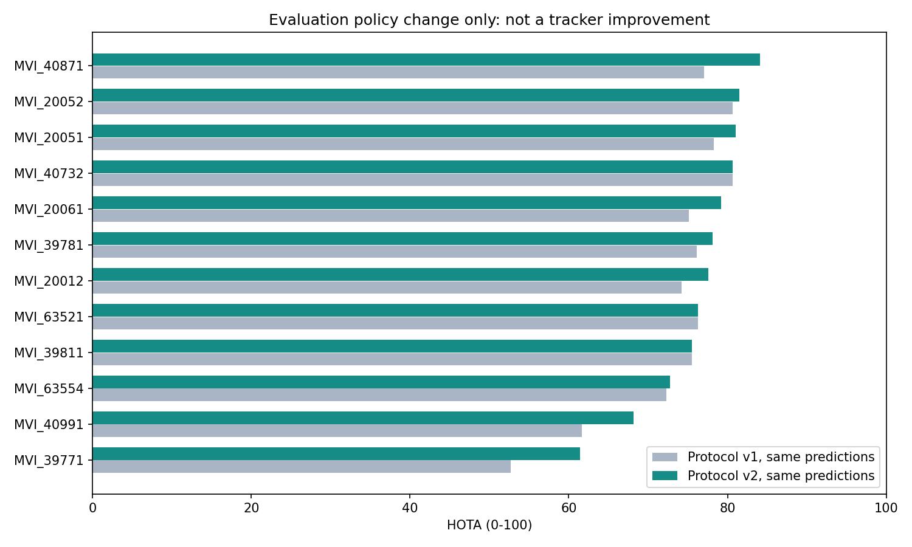
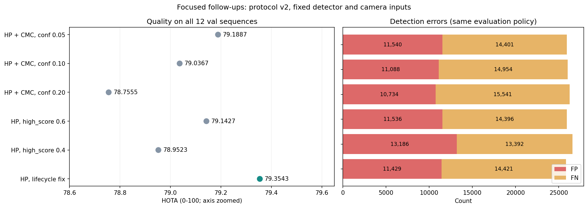
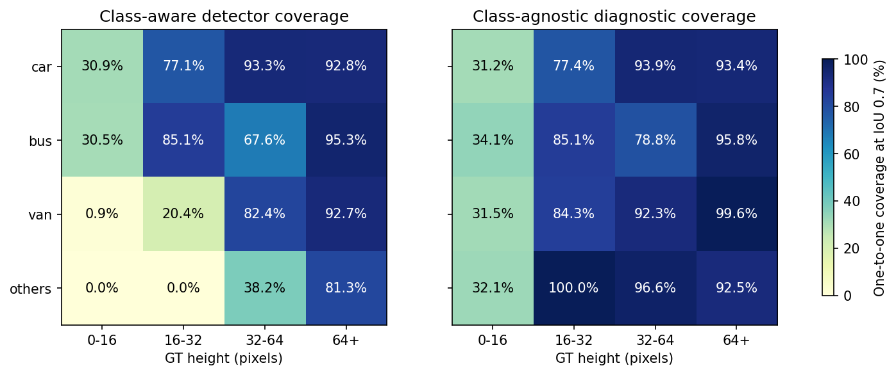
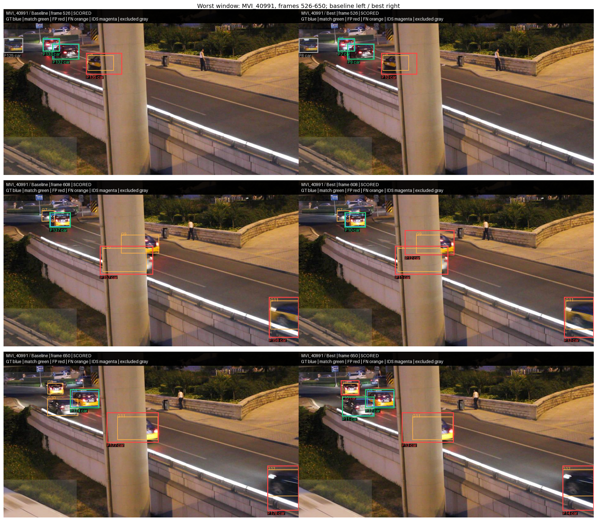

# Báo cáo sửa pipeline và validation protocol v2

> Đây là mốc validation v2 được giữ nguyên số liệu. Các cải thiện class/measurement
> tiếp theo ở [TRACKING_REFINEMENT_V3_REPORT.md](TRACKING_REFINEMENT_V3_REPORT.md).

Ngày: 28/11/2026. Môi trường chạy: local Windows. Phạm vi: 12 val sequences,
16.001 frame tracking, 15.274 frame được đánh giá; không chạy test.

Đã chấm lại 15 cấu hình cũ và chạy 5 lượt tracking full-val mới: một lượt tái lập
và bốn biến thể có đối chứng. Tổng cộng 19 cấu hình/algorithm variants khác nhau
được đánh giá; lượt tái lập không tính là một cấu hình tuning mới.

**Cấu hình được chọn: HP + sửa lifecycle, không CMC**, HOTA **79,3543**,
IDF1 **87,8485**. Output ở `validation_v2/runs/coasting_fix_hp`. Kết quả này
được chọn theo HOTA class-aware tổng hợp trên val, không phải kết quả test.

## 1. Sửa gì và dựa trên bằng chứng nào

Ca tái hiện tối thiểu trước sửa: một GT và prediction trùng khít, cùng nằm trong
ignore, vẫn tạo 1 FN do evaluator loại prediction nhưng giữ GT. Kiểm thử đi qua
`evaluate_run` đã thất bại trước sửa và qua sau sửa; đồng thời kiểm tra file
canonical không thay đổi byte nào.

Đối chiếu XML gốc cho thấy tọa độ ignore khớp canonical ở cả 95 sequence có vùng
ignore. Toolkit gốc cũng xử lý GT trong ignore tại
`data/raw/Toolkit/DETRAC-MOT-toolkit/utils/parseGT.m`, và xử lý prediction tại
`evaluation/dropTracks.m`. Vì vậy không có bằng chứng để sửa tọa độ raw/canonical;
vấn đề được xác nhận là chính sách đánh giá bất đối xứng.

Protocol v2 áp dụng cùng helper union ignore và ngưỡng 50% diện tích nhìn thấy
cho **cả GT và prediction tại evaluation**. Không sửa raw, canonical, detections,
calibration hoặc fixed splits; không thêm lọc theo kích thước, occlusion hay
truncation. Tracking vẫn chạy đủ timeline 25 FPS, kể cả frame chưa annotation.

Đây là protocol của đồ án, không phải bản sao chính xác toolkit/PR-MOTA: toolkit
còn có bước trim đoạn quỹ đạo, round tọa độ và quy ước pixel khác. V2 dùng lọc
từng observation theo raster union hiện có của project. CLEAR/Identity vẫn dùng
IoU 0,7; HOTA dùng 0,05–0,95; tổng hợp bằng TrackEval combine.

## 2. Cùng prediction, thay protocol

Tham chiếu là output `af8a55feaf077058`, không đổi tracking.

| Chỉ số | Protocol v1 | Protocol v2 |
|---|---:|---:|
| HOTA | 75,8641 | 79,1887 |
| IDF1 | 84,6309 | 87,5836 |
| MOTA | 72,6666 | 77,6044 |
| FP | 11.456 | 11.540 |
| FN | 22.459 | 14.401 |
| IDS | 132 | 132 |
| Frag | 978 | 971 |

Tập GT được chấm giảm từ 124.562 xuống 116.420 observations: 8.142 observations
bị loại theo ignore. FN giảm 8.058, còn FP tăng 84 do tập GT và matching thay đổi.
Đây **không phải mức cải thiện của mô hình**. Mọi cấu hình đã được chấm lại cùng
v2 trước khi xếp hạng, thay vì so một cấu hình v2 với baseline v1.

Tại MVI_40871, v2 loại 5.249 GT observations theo ignore; FN của run tham chiếu
giảm 9.816 → 4.600. G36 không còn GT observation được chấm; G11 vẫn còn 694
observations ngoài ignore và chưa được tracker match. Coverage detector của
694 observations này là khoảng 22,91%, nên vấn đề thực chưa được giải quyết hết.



## 3. Chấm lại 15 cấu hình và các lượt follow-up

15 cấu hình cũ đã được chấm lại trên đủ 12 val sequences. Top 5 theo HOTA v2:

| Cấu hình | HOTA | IDF1 | FP | FN | IDS |
|---|---:|---:|---:|---:|---:|
| HP + CMC | 79,1887 | 87,5836 | 11.540 | 14.401 | 132 |
| HP, không CMC | 79,1427 | 87,5085 | 11.536 | 14.396 | 137 |
| CMC, không HP | 79,0628 | 87,6408 | 10.780 | 15.167 | 105 |
| Combined parameters | 79,0150 | 87,5636 | 10.782 | 15.164 | 114 |
| Interpolation | 78,6731 | 87,2209 | 12.882 | 14.179 | 106 |

Các lượt chạy mới gồm: tái lập cấu hình thắng trên toàn val, thử confidence
0,10/0,20 với cùng cấu hình, và thử high_score 0,4 trên nhánh HP không CMC.
High_score được so với nhánh HP high_score 0,6 tương ứng, không dùng sự khác biệt
CMC để quy kết lợi ích của high_score.

| Nhánh, cùng protocol v2 | HOTA | IDF1 | FP | FN | IDS |
|---|---:|---:|---:|---:|---:|
| HP + CMC, conf 0,05: tham chiếu | 79,1887 | 87,5836 | 11.540 | 14.401 | 132 |
| HP + CMC, conf 0,10 | 79,0367 | 87,4702 | 11.088 | 14.954 | 133 |
| HP + CMC, conf 0,20 | 78,7555 | 87,0155 | 10.734 | 15.541 | 129 |
| HP không CMC, high_score 0,6: đối chứng | 79,1427 | 87,5085 | 11.536 | 14.396 | 137 |
| HP không CMC, high_score 0,4 | 78,9523 | 87,3054 | 13.186 | 13.392 | 144 |
| HP không CMC, high_score 0,6 + lifecycle fix | **79,3543** | **87,8485** | **11.429** | **14.421** | **134** |

Tăng confidence giảm FP nhưng tăng FN và làm HOTA giảm trong hai lượt thử.
Hạ high_score giúp giảm 1.004 FN so với nhánh HP tương ứng, nhưng tăng 1.650 FP
và làm HOTA giảm 0,1903 điểm. Không chọn các thay đổi threshold này.

Lifecycle fix so với **đúng đối chứng HP không CMC** cải thiện HOTA 0,2116 điểm,
IDF1 khoảng 0,3400 điểm, giảm 107 FP và 3 IDS; FN tăng 25. So với cấu hình
đứng đầu cũ khi cùng chấm v2, cấu hình mới tăng HOTA 0,1656 điểm, nhưng phép so
sánh sau còn khác cả CMC nên không dùng để quy toàn bộ tác động cho lifecycle.
Không kết luận mọi metric đều cải thiện hoặc đã hết lỗi bỏ sót.



Chi phí khởi động CMC cần được tính riêng: lượt tái lập mất khoảng **486 giây**
từ log bắt đầu run đến sequence đầu tiên, chủ yếu ở bước kiểm tra input/hash ảnh.
Runtime tracker trong leaderboard cũ không phản ánh đủ chi phí này. Các lượt mới
có chạy đồng thời một phần; runtime giữa chúng không phải benchmark tốc độ có
kiểm soát tải máy. Theo HOTA đã lưu, HP không CMC chỉ thấp hơn HP + CMC khoảng
0,046 điểm, là phương án đáng cân nhắc nếu chi phí I/O/runtime quan trọng.

## 4. Phân loại lại FN theo dữ liệu detector

Audit dùng matching one-to-one trên GT và detections được chấm theo v2. Một
detection không được tính là hai match cho hai GT. Class-agnostic chỉ là phép
chẩn đoán, không dùng để lựa chọn tracker.

| Nhóm chẩn đoán FN của run tham chiếu | Observations | Tỷ lệ |
|---|---:|---:|
| Candidate cùng class có IoU 0,5–0,7 | 5.320 | 36,94% |
| Không có candidate cùng class IoU 0,5, và không có candidate khác class IoU 0,7 | 5.094 | 35,37% |
| Có candidate one-to-one cùng class IoU ≥0,7 | 2.089 | 14,51% |
| Có candidate khác class IoU ≥0,7, thiếu candidate cùng class đạt ngưỡng | 1.897 | 13,17% |
| Có candidate cùng class đạt 0,7 nhưng bị cạnh tranh one-to-one | 1 | 0,01% |
| Tổng | 14.401 | 100% |

Đây là các nhóm ứng với thứ tự ưu tiên của script, không phải nhãn nguyên nhân
vật lý tuyệt đối. Candidate tốt chưa chứng minh một lỗi association cụ thể;
cần xem assignment, trạng thái track và gating thực tế. Candidate khác class
cũng có thể chồng một đối tượng lân cận.

Các nhóm khó được xác nhận trên toàn val:

- Car cao ≤16 px: coverage cùng class IoU 0,7 là 30,88% trên 1.415 observations;
  nhóm cao 32–64 px đạt 93,27% trên 46.707 observations.
- Van cao 16–32 px: coverage cùng class 20,40%, so với class-agnostic 84,26%, trên
  451 observations. Đây là bằng chứng cần review nhầm class, không chỉ tăng recall.
- Nhóm others nhỏ có ít observations, không nên suy rộng chỉ từ các tỷ lệ này.

Không hạ IoU đánh giá để che lỗi localization. Muốn cải thiện các nhóm này cần
đánh giá bbox/class của detector, chất lượng nhãn, độ phân giải inference và
sampling train theo track/sequence; không chỉ tăng thời gian giữ track.
Runner xuất bbox của detection được ghép, nên tuning Kalman/association không
tự sửa được bbox nguồn nếu không có candidate đủ IoU. Việc chọn mẫu khó để
train tiếp phải thực hiện trong fixed train split; không chuyển frame val vào train.



## 5. Cơ chế đổi ID tại biên ảnh đã có trace

Trace của run tái lập HP + CMC tham chiếu, MVI_39771, car G2:

| Frame | Detection ID | Track ID/trạng thái | Cost với P2 | Ground Y | Variance Y |
|---|---:|---|---:|---:|---:|
| 43 | 256 | P2, Confirmed | 34,3902 | -1,198374 | 0,023637 |
| 44 | 263 | P10, Tentative/new | 45,7353 | -1,198374 | 0,018740 |
| 45 | 270 | P10, Tentative | 95,5174 | -1,198374 | 0,013910 |

Ngưỡng a1 là 40: tại frame 44, candidate không qua gating với P2 và một track
mới được tạo. Cost P10 với detection frame 45 chỉ khoảng 0,2486. Đáy bbox đều
ở y=540 nên ground Y đóng băng khi xe ra biên; covariance đo giảm khi chiều cao
bbox bị cắt ngắn. HP đưa phần đầu P10 vào output sau khi track được xác nhận,
nên evaluator thấy chuyển ID ngay ở frame 44.

Đã xác nhận cơ chế gating ở ca này, nhưng chưa chứng minh nên tăng a1 toàn cục
hay thay công thức noise. Giữ công thức mapper upstream trong đợt này. Bước sau
cần thử nghiệm riêng xử lý measurement bị cắt ở biên, có control và kiểm tra
trade-off IDS/FP trên toàn val.

## 6. Lỗi lifecycle khi không có low-score detections

Ca tái hiện trực tiếp trên clone: xác nhận một track qua ba frame có detection,
sau đó đưa sáu frame rỗng với `max_age=3`. Upstream vẫn giữ track ở trạng thái
Confirmed với `death_count=7`. Adapter không bỏ qua frame rỗng trong phép thử.

Nguyên nhân trong clone là nhánh association low-score không có cặp để xét:
track unmatched không được chuyển sang Coasted, trong khi bước hết hạn chỉ xóa
Coasted hoặc Tentative. Vì vậy max_age không giới hạn mọi chuỗi mất detection
theo cách người dùng thường kỳ vọng.

Thêm [`src/tracking/lifecycle.py`](../src/tracking/lifecycle.py) để sửa qua wrapper
của project, không sửa file tracker/Kalman trong clone. Khi bật `fix_coasting`,
wrapper chuyển unmatched Confirmed sang Coasted, loại track đã đến tuổi hết hạn
và dựng lại index lists. Không tăng death_count lần thứ hai, không thay matching,
bbox, measurement noise hoặc ID của các track đang match.

Nhánh này tách riêng bằng `--fix-coasting` và provenance `fix_coasting=true`.
Mặc định vẫn giữ hành vi upstream để tái lập baseline. Đối chứng full-val dùng
cùng cấu hình HP không CMC/high_score=0,6; algorithm variant được đưa vào khóa
xếp hạng để không gộp nhầm với cấu hình upstream có cùng hyperparameters.

Đối chứng đã chạy đủ 12 sequence với input/calibration và các hyperparameters
giống nhánh HP: HOTA 79,1427 → 79,3543, IDF1 87,5085 → 87,8485.
Đây là nhánh được chọn trong đợt này; cần bật flag khi chạy cấu hình đã lưu.
Lifecycle fix không đồng nghĩa sửa cơ chế measurement bị cắt ở biên, không
thay công thức noise upstream, và không loại hết IDS/FN.

## 7. Kiểm thử, case analysis và sử dụng

- 26 kiểm thử tracking/evaluator/đóng gói và 3 kiểm thử analysis đã qua.
- Kiểm thử lifecycle tái hiện cả hành vi upstream và nhánh hết hạn đã sửa;
  kiểm thử đóng gói bảo đảm hai algorithm variants không bị deduplicate nhầm
  và không ghi đè evaluation v1 khi tạo artifact v2.
- Kiểm tra dữ liệu đầu vào metric sau tối ưu dựng NumPy arrays cho kết quả bằng
  cách dựng cũ trên timeline thưa, thứ tự hàng xáo trộn và frame rỗng.
- Audit FN của run tham chiếu khớp FP/FN/IDS/Frag của evaluator trên đủ 12 sequence.
- Notebook đọc version từ `evaluation/protocol.json`, hỗ trợ mở lại v1 mà không
  áp dụng nhầm bộ lọc GT v2.

Lượt tracking tái lập đã hoàn tất đủ 12 sequence; `reproduction_check.json`
cho kết quả `true` với checksum của cả 12 file tracks CSV. Do đó trace không
làm thay đổi output, và chênh lệch score v1/v2 của run tham chiếu đến từ protocol.

Notebook case analysis đã chạy lại trên cấu hình được chọn và baseline cùng v2.
FP/FN/IDS/Frag khớp evaluator cho đủ 24 cặp sequence/run. Các đoạn mới được chọn:

| Đoạn 125 frame | GT observations | FP | FN | IDS | F1 cục bộ |
|---|---:|---:|---:|---:|---:|
| Tốt nhất: MVI_20051, 501–625 | 1.090 | 7 | 8 | 0 | 99,31% |
| Xấu nhất: MVI_40991, 526–650 | 474 | 125 | 180 | 0 | 65,85% |

Cả hai có đủ annotation. Không so các cửa sổ này với cửa sổ v1 như cùng một
phép đo, vì lựa chọn và GT được chấm đã thay đổi. Đoạn xấu vẫn không có IDS,
nhưng nhiều FP/FN: vấn đề còn lại không chỉ là giữ ID.

Tại MVI_40991 frame 608, IoU giữa G9/P12 là 0,5581, G11/P13 là 0,6581, đều
dưới 0,7 dù ảnh vẫn nhìn thấy xe. Ảnh có trụ cầu và lan can che khuất; XML G9
khai báo hai `region_overlap`. Đây là ca cần review localization/extent bbox
khi có occlusion, không phải bằng chứng nên xóa GT hay hạ ngưỡng evaluation.



Chấm lại và chạy follow-up:

```powershell
python scripts/revalidate_tracking.py --workers 3 --followups
python scripts/audit_tracking_detections.py
python scripts/audit_tracking_errors.py
```

Output: [`validation_v2`](../outputs/tracking/validation_v2/). Bảng xếp hạng 15 run
cũ ở `leaderboard.csv`; dữ liệu detector ở `detection_audit`; events/FN đã phân
loại ở `reference_error_audit`; trace ở `runs/reproduce_v2_winner/association_trace`.
File checksum input và protocol đi kèm để kiểm tra provenance.

Artifact được chọn:

- [`best_config.json`](../outputs/tracking/validation_v2/best_config.json):
  `fix_coasting=true`, `conf=0.05`, `high_score=0.6`, `a1=a2=40`, `wx=wy=10`,
  `vmax=15`, `max_age=30`, `fps=25`, HP bật, CMC/interpolation tắt.
- [`best_val_v2.yaml`](../configs/tracking/best_val_v2.yaml): hyperparameters.
- [`tracks`](../outputs/tracking/validation_v2/runs/coasting_fix_hp/tracks/) và
  [`mot`](../outputs/tracking/validation_v2/runs/coasting_fix_hp/mot/): đủ 12 sequence.
- [`all_trials.csv`](../outputs/tracking/validation_v2/all_trials.csv): 19 cấu hình/
  algorithm variants, loại trùng lượt tái lập; ưu tiên HOTA, IDF1, IDS rồi runtime.
- [`preservation_check.json`](../outputs/tracking/validation_v2/preservation_check.json):
  kiểm tra 5 file input quan trọng và 180 file tracking lịch sử không thay đổi.

Chạy cấu hình được chọn vào thư mục mới:

```powershell
python scripts/tracking_pipeline.py run --config configs/tracking/best_val_v2.yaml --calibration outputs/tracking/calibration/registry_approved_h_v1.json --fix-coasting --output outputs/tracking/run_best_val_v2
python scripts/tracking_pipeline.py evaluate --output outputs/tracking/run_best_val_v2
```

Mặc định các đường dẫn dataset/detections là những input đã dùng trong đợt này;
đổi `--dataset`/`--detections` nếu chạy trên Colab hoặc máy khác. Nếu code/input
đã đổi, chọn output mới để giữ provenance; không ép resume qua fingerprint khác.

Đặt `UA_DETRAC_EXPERIMENT` tới thư mục `outputs/tracking/validation_v2` để mở
notebook case analysis trên kết quả mới. Bảng count kiểm tra, ảnh và GIF được
lưu trong [`case_analysis`](../outputs/tracking/validation_v2/case_analysis/).

Đợt này chưa train lại detector, chưa thay calibration và chưa triển khai sửa
class hoặc measurement noise. Các kết luận về xe nhỏ, localization, class và
biên ảnh là đầu vào cho đợt cải thiện tiếp theo; không coi chúng là lỗi đã hết.

## 8. Định vị các bản vá của mốc v2

| Phần sửa | Vị trí | Động cơ |
| --- | --- | --- |
| Lọc ignore đối xứng, protocol có version | [`PROTOCOL`, `filter_evaluation_boxes`](../src/tracking/evaluation.py#L40), [`evaluate_run`](../src/tracking/evaluation.py#L257) | GT trong ignore trước đây vẫn tạo FN sau khi prediction tương ứng bị loại; chỉ sửa evaluation, giữ dữ liệu gốc. |
| Hết hạn track unmatched | [`update_tracker`](../src/tracking/lifecycle.py#L4), [`flag CLI`](../scripts/tracking_pipeline.py) | Upstream bỏ chuyển Confirmed→Coasted khi không có cặp low-score; wrapper sửa transition và expiry, không tăng death_count hai lần. |
| Cache có provenance | [`evaluation_fingerprint`](../src/tracking/evaluation.py#L107), [`run_tracking`](../src/tracking/runner.py#L137) | Tránh dùng lại score khi GT/protocol/prediction hoặc code/input tracking đã đổi. |
| Chẩn đoán có đối chiếu metric | [`diagnose`](../src/analysis/tracking_cases.py#L23), [`detection_audit.py`](../src/analysis/detection_audit.py) | Phân biệt bỏ sót, sai class, IoU thấp và đổi ID; count phải khớp evaluator. |

Các kiểm thử tương ứng nằm trong `tests/tracking/test_ignore_v2.py`,
`test_lifecycle.py`, `test_validation_delivery.py` và `tests/analysis/`.
