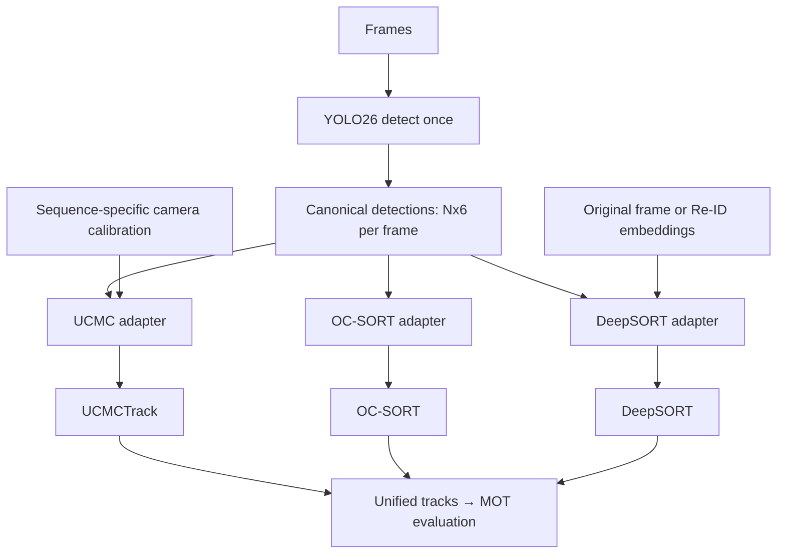

# YOLO26 → MOT Tracker Adapter Contract

**Scope:** UA-DETRAC; YOLO26 (Ultralytics) detection; UCMCTrack, OC-SORT, DeepSORT. **Design/specification only — no implementation requested.**

## Architecture

## YOLO26 output contract

Ultralytics `Results` (one per frame):

- `result.boxes.xyxy`: `(N,4)`, `[x1,y1,x2,y2]`, **original-image pixel coordinates**.
- `result.boxes.conf`: `(N,)`, confidence scores.
- `result.boxes.cls`: `(N,)`, class IDs; cast to integer.
- `result.orig_shape`: `(height,width)`.
- Do **not** confuse Ultralytics `boxes.xywh` (center-based) with top-left `ltwh`.

**Canonical per-frame matrix:** `float32 (N,6) = [x1,y1,x2,y2,confidence,class_id]` (class IDs have integral values). Use `(0,6)` for empty frames. `frame_id` is 1-based; retain `sequence_id`, original image dimensions and frame order in frame metadata. Persist sequence FPS, class map, detector weights/version, inference parameters and source identity. Do not add `track_id` to detections.

## Adapter conversion requirements

| Adapter | Input to underlying tracker | Required transformation / dependency |
|---|---|---|
| **UCMCTrack** | Detection objects: `bb_left`, `bb_top`, `bb_width`, `bb_height`, `conf`, `det_class`, mapped measurement `y`, covariance `R` | `xyxy → ltwh`; initialize Detection; call ground-plane Mapper per detection to produce `y,R`; supply **valid per-sequence camera parameters**, FPS and frame ID; follow pinned upstream update API. Fail explicitly if calibration is unavailable. |
| **OC-SORT** | `(N,5)` `[x1,y1,x2,y2,score]` | Drop `class_id`; preserve score; call update for **every** frame including `(0,5)`. Original upstream `update(output_results,img_info,img_size)` internally rescales boxes: if canonical coordinates are already original pixels, ensure effective scale = 1 (or adapt to pinned fork). No double scaling. |
| **DeepSORT** | `([left,top,width,height], confidence, class)` per detection for `deep-sort-realtime` | `xyxy → ltwh`; provide **original matching frame** for Re-ID extraction OR matching, ordered appearance embeddings; preserve detection-to-embedding alignment. Pin library variant (original DeepSORT API differs). |

## Common invariants and acceptance criteria

1. Run detector **once** and feed identical persisted canonical detections to all three tracker adapters; tracker-specific thresholds/configuration may differ but must be recorded.
2. `xyxy` uses original-image pixels; `width=x2-x1`, `height=y2-y1`; validate finite values, positive box dimensions, score range, and class mapping.
3. Never skip empty frames; reset tracking state at each sequence boundary; preserve 1-based frame numbering and chronological order.
4. Do not silently manufacture camera calibration, Re-ID embeddings or track confidence values. Keep native algorithm behavior intact.
5. Normalize tracker outputs to `{frame_id, track_id, bbox_xyxy, class_id?, score?}`. Export MOTChallenge rows as `frame,id,left,top,width,height,score,-1,-1,-1` according to the selected evaluator's score conventions.
6. Record pinned upstream commits, class-aware vs. class-agnostic policy, inference settings, calibration provenance, Re-ID extractor and tracking parameters. Evaluate all trackers on identical sequences/protocol.

## Source-of-truth interfaces

- YOLO26 / Ultralytics: https://docs.ultralytics.com/tasks/detect/ and https://docs.ultralytics.com/modes/predict/
- UCMCTrack: https://github.com/corfyi/UCMCTrack (`demo.py`, Mapper)
- OC-SORT: https://github.com/noahcao/OC_SORT (`trackers/ocsort_tracker/ocsort.py`)
- `deep-sort-realtime`: https://github.com/levan92/deep_sort_realtime (`deepsort_tracker.py`)

**Before implementation:** Inspect the pinned dependency revisions and reconcile any differences between their actual method signatures and this contract. Do not modify tracker internals merely to fit the canonical format; isolate conversion in adapters.
